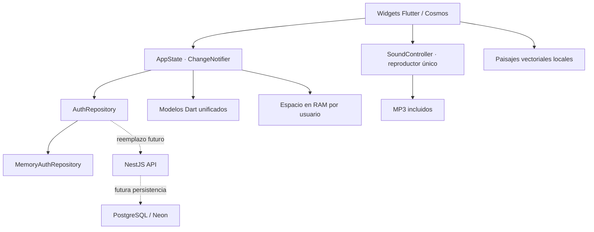

# Arquitectura de CEOSMOS Móvil Integral

## Fuentes consultadas

- Reporte de avances de esta carpeta: alcance y entregables.
- `C:\CESAR10cuatri\CEOSMOS_flutter\memoria.md`: modos, sesión global, wearable, TV y defectos previos.
- `C:\CESAR10cuatri\CEOSMOS_web\memoria.md`: diseño, API y autenticación.
- `C:\CESAR10cuatri\CEOSMOS_integral\Documento-Arquitectura-Integral.md`: contratos comunes, responsabilidades y eliminación de duplicidades.
- Código de `WEBANGULAR/frontend`: feed, filtros y experiencia cósmica.
- Código de `WEBANGULAR/ceosmos-api`: esquema Prisma y controlador de autenticación.
- `C:\Users\cesar\Ceosmos`: base Angular inicial.
- Carpeta CEOSMOS de Dispositivos Inteligentes adjunta: contiene un prototipo/plugin Figma, no el monorepositorio Flutter descrito en su memoria. La memoria se utiliza como referencia funcional, sin afirmar que se migró código Flutter no disponible.

Se respetó la indicación de consultar en `C:\CESAR10cuatri` únicamente carpetas con CEOSMOS en el nombre. Los enlaces de las memorias a otras carpetas no se siguieron.

## Decisiones

El reporte más reciente y la solicitud actual prevalecen sobre las propuestas históricas: implementación local sin BD; en la futura integración de hardware, TCP/IP primario y BLE de respaldo. La propuesta anterior de Firestore como proyección no se implementa aquí.

No se importan Firebase, Firestore ni `dart:html`. La navegación privada aparece únicamente si hay sesión de acceso. Una instancia global de estado es responsable del temporizador y de los espacios de usuario. Se liberan timers, reproductor, controladores de texto y scroll al desechar sus propietarios.

## Modelos y correspondencias

| Dart | Origen / destino previsto | Decisión |
| --- | --- | --- |
| AppUser | Prisma User | Conserva id/email/username; el rol local es USER |
| AuthSession | Prisma Session | Acceso y caducidad; en demo no hay token. Futuro JWT será responsabilidad del servidor |
| FocusSession | Sesiones/historial del móvil previo | Nuevo agregado distinto de AuthSession; usuario, contenido, modo, fechas, duración activa y estado |
| MediaItem | Prisma MediaItem + Contenido del móvil | Contrato de catálogo local: audio/imagen, título y modo; requiere adaptación al backend existente |
| LinkedDevice | Dispositivos/vinculaciones previas | usuario, nombre, tipo, fecha y configuración |
| UserWorkspace | Favoritos/preferencias/historial | En RAM; nunca se comparte entre identidades |

### Consideraciones del esquema real

El Prisma inspeccionado usa `MediaType { YOUTUBE, IMAGE }`, no MP3/AAC. Para admitir audio nativo debe añadirse `AUDIO` y sus metadatos o acordar un DTO nuevo. No enviar `AUDIO` al backend actual suponiendo que ya lo acepta. Los campos anidados `metadata` y `configuration` de los modelos Dart son una propuesta de contrato; no se afirma que existan columnas JSONB desplegadas.

Propuesta relacional futura: User 1:N FocusSession; User 1:N LinkedDevice; User N:M MediaItem a través de Favorite; preferencias por usuario. `FocusSession.metadata`, `LinkedDevice.configuration` y preferencias variables pueden mapearse a JSONB. Relaciones e índices deben implementarse como migración revisada en el backend.

### API existente y trabajo pendiente

- `POST /api/auth/register`, `/login`, `/logout`: ya definidos en el controlador web consultado.
- `GET /api/users/me`, `/me/sessions` y `PATCH /api/users/me/preferences`: descritos en la memoria web.
- WebAuthn: `POST /api/auth/webauthn/{register|login}/{options|verify}`.
- El login inspeccionado establece cookie `Authentication` httpOnly y cookie CSRF y devuelve token. No asumir que todos los clientes pueden usar un Bearer token sin revisar guard, estrategia JWT y middleware CSRF.
- Para Web: resolver envío de cookies, origen/CORS y CSRF. Para Android/iOS: acordar transporte seguro, almacenamiento seguro y cierre/revocación; nunca guardar un JWT en preferencias sin protección.
- Passkeys móviles requieren servidor de challenges y asociación verificada de app/dominio. El botón informativo actual no invoca biometría.
- Focus sessions, favoritos y dispositivos necesitan comprobarse/extenderse en el servidor antes de conectar sus repositorios.

No se incluye una URL real de producción ni secretos. No se leen archivos `.env` de los otros proyectos.

## Estado y tiempo

El reloj de acceso expira tras dos horas y cierra cualquier actividad abierta. El temporizador de enfoque acumula segmentos activos y utiliza diferencias entre instantes, no un decremento dependiente de la frecuencia de renderizado. El historial registra segundos realmente activos hasta el objetivo. Reemplazar un ambiente finaliza la sesión anterior. Cerrar sesión conserva en memoria el historial del usuario durante la ejecución.

El audio es una experiencia de primer plano: la app lo detiene al ocultarse, al finalizar o al cerrar sesión. Reanudar el contador permite volver a activar el ambiente explícitamente. Solo se crea un `AudioPlayer` por shell autenticado.

## Alcance de seguridad de la demo

Los correos se normalizan, se rechazan duplicados y las contraseñas tienen mínimo de ocho caracteres. Se guardan únicamente digest SHA-256 con sal aleatoria en memoria; esto no es un esquema de almacenamiento de contraseñas para producción. El backend seguirá utilizando su mecanismo de password hashing, bloqueo de cuenta, verificación de correo y JWT reales. La demo no replica dichas garantías.
