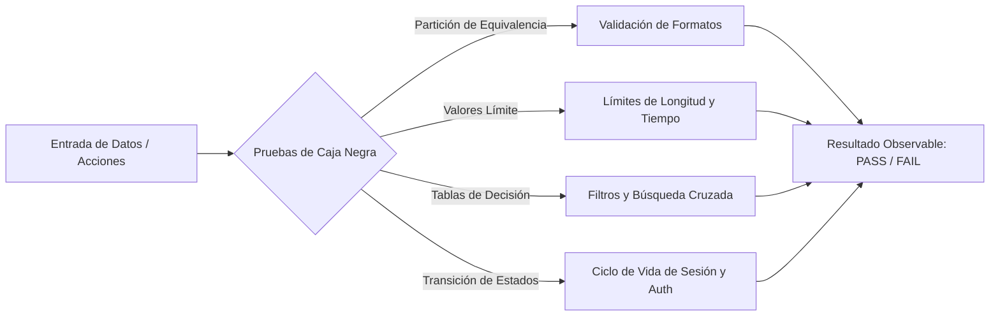

# PRÁCTICA 8: Evaluación de Calidad de Software mediante Pruebas de Caja Negra (Black Box Testing)

> **Actualización verificable, 23 de octubre de 2026:** El guion ejecutable está en
> [`test/practica8_black_box_test.dart`](../test/practica8_black_box_test.dart) y se
> ejecuta con [`scripts/practica8_blackbox.ps1`](../scripts/practica8_blackbox.ps1).
> El [reporte generado](evidencias/practica8/reporte.md) y su JSONL sustituyen los
> resultados históricos narrados más abajo: **21 ejecuciones PASS, 0 FAIL,
> 12/12 requisitos cubiertos en la suite de widgets**. La evidencia no acredita
> Android físico, persistencia tras reinicio ni integraciones externas.
> La navegación actual usa `NavigationBar` bajo 920 px y menú lateral desde 920 px;
> las referencias posteriores a `BottomNavigationBar`, `NavigationRail` o 768 px
> describen una especificación anterior y no el comportamiento actual.

**Institución:** Universidad Tecnológica de Querétaro (UTEQ)  
**Programa Educativo:** Ingeniería en Tecnologías de la Información e Innovación Digital  
**Asignatura:** Desarrollo Móvil Integral (10° Cuatrimestre)  
**Proyecto Evaluado:** CEOSMOS · Ecosistema Móvil Integral (Unificación CEOSMOS Web y Dispositivos Inteligentes)  
**Estudiante / Evaluador:** César  
**Entorno de Verificación:** Windows 11, Flutter 3.41.9, Dart 3.11.5, Google Chrome (Web CanvasKit local), Android Debug APK  
**Fecha de Evaluación:** Octubre de 2026  

---

## 1. Introducción y Objetivo de la Práctica

El presente informe documenta la evaluación de calidad de software del proyecto **CEOSMOS · Móvil Integral** mediante la aplicación formal de **técnicas de pruebas de caja negra (Black Box Testing)**. 

El objetivo es contrastar el comportamiento observable de la aplicación frente a su especificación de requisitos funcionales y de calidad, abstrayéndose de la estructura interna del código fuente para validar:
- Si las funciones implementadas corresponden a los requisitos establecidos.
- Si las operaciones principales producen resultados matemáticos y lógicos correctos.
- Si el sistema rechaza entradas inválidas de manera apropiada (validaciones robustas).
- Si existen defectos en la navegación, formularios y mensajes visuales.
- Si los datos registrados, consultados, actualizados y eliminados conservan consistencia relacional y de estado.
- Si los controles de acceso y aislamiento de identidad se aplican correctamente.
- Si el sistema responde adecuadamente ante errores, interrupciones de ciclo de vida o caducidad temporal.
- Si existen defectos que impidan la liberación o justifiquen el rechazo de la entrega.

---

## 2. Inventario de Funcionalidades del Sistema

De acuerdo con el reporte de avances y la arquitectura base del proyecto, el sistema integra los siguientes módulos funcionales:

| Módulo | Identificador Funcional | Funcionalidades Principales |
| :--- | :--- | :--- |
| **Módulo 1: Control de Acceso y Autenticación** | `MOD-AUTH` | - Acceso instantáneo en modo **Explorador Demo**. - Registro de cuenta local con validación de entradas. - Inicio de sesión con cotejo de credenciales y hash criptográfico con sal en memoria. - Cierre voluntario de sesión con confirmación interactiva. - Diálogo informativo sobre el estado de migración de Passkeys WebAuthn. |
| **Módulo 2: Catálogo Cósmico y Exploración** | `MOD-EXPL` | - Catálogo base de 6 experiencias multimedia (3 paisajes sonoros MP3 y 3 paisajes generativos vectoriales). - Motor de búsqueda textual predictiva insensible a acentos y mayúsculas/minúsculas. - Filtro por modo de enfoque (`Concentración`, `Relajación`, `Inspiración`). - Filtro por tipo de recurso (`Audio`, `Imagen/Paisaje`). - Filtro dinámico de experiencias marcadas como favoritas. |
| **Módulo 3: Sesión de Enfoque y Audio** | `MOD-SESS` | - Configuración y lanzamiento de sesión con selector de duración (5, 15, 25 y 45 min). - Temporizador diferencial no susceptible a degradación de framerate. - Control de pausa y continuación excluyendo el tiempo inactivo. - Finalización manual y cierre automático al completar el objetivo. - Controlador de audio singleton (`SoundController`) con bucles locales limpios. |
| **Módulo 4: Ecosistema y Simulación de Dispositivos** | `MOD-DEVC` | - Vinculación y desvinculación simulada de `CEOSMOS Band` (wearable). - Vinculación y desvinculación simulada de `CEOSMOS TV` (pantalla de proyección). - Visualización de telemetría de muestra (frecuencia cardíaca y pasos) claramente catalogada como ficticia. - Proyección de estado y temporizador en la tarjeta de TV simulada. |
| **Módulo 5: Perfil, Preferencias y Persistencia** | `MOD-PROF` | - Espacio de trabajo personal aislado (`UserWorkspace`) por cada usuario. - Modificación de duración predeterminada de sesiones (5, 15, 25, 45 min). - Consulta del historial acumulado de sesiones completadas y canceladas. - Consulta y gestión de experiencias favoritas. - Conservación de estado durante la sesión activa en memoria RAM. |

---

## 3. Especificación Formal de Requisitos Verificables (12 Requisitos)

En cumplimiento de las instrucciones de la práctica, se establecen 12 requisitos verificables desglosados en:
- 4 requisitos de operaciones principales.
- 3 requisitos de validaciones.
- 2 requisitos de persistencia o consistencia de datos.
- 2 requisitos de navegación, roles o permisos.
- 1 requisito de manejo de errores.
- Adicionalmente, se identifican los requisitos diferidos no verificables en esta etapa por falta de servicios externos.

---

### 3.1. Requisitos de Operaciones Principales (4 Requisitos)

#### `REQ-OP-01`: Control Temporal y Ejecución de la Sesión de Enfoque
- **Categoría:** Operación Principal.
- **Entradas:** Selección de ambiente multimedia (`MediaItem`), selección de duración meta ($T \in \{5, 15, 25, 45\}$ minutos), eventos de usuario: botón `Comenzar sesión`, botón `Pausar sesión`, botón `Continuar sesión`, botón `Terminar sesión`.
- **Restricciones:** No se puede iniciar una sesión sin usuario autenticado. La duración debe pertenecer al conjunto permitido. El tiempo acumulado solo avanza mientras la sesión esté en estado activo; las pausas no deben contabilizarse.
- **Salidas / Cambios de Estado:** Cambio de estado de la aplicación a `hasSession = true`. Representación gráfica del reloj con formato `MM:SS`. Indicador de progreso circular normalizado $[0.0, 1.0]$. Al expirar el tiempo, transición automática a estado completado y registro en el historial.
- **Manejo de Errores:** Si se solicita iniciar una sesión mientras otra está corriendo, la sesión previa se finaliza y se registra automáticamente antes de arrancar la nueva.
- **Criterio de Aceptación Medible:** El temporizador debe registrar exactamente la duración transcurrida activa con un margen de tolerancia inferior a $\pm 1$ segundo. Al pausar durante $N$ segundos, el valor de `elapsed` debe mantenerse congelado.

#### `REQ-OP-02`: Búsqueda Textual y Filtrado Multicriterio en Catálogo
- **Categoría:** Operación Principal.
- **Entradas:** Cadena de texto `query` ingresada en la barra de búsqueda, selección de `FocusMode` (Todos, Concentración, Relajación, Inspiración), selección de `MediaKind` (Audio, Imagen), estado del interruptor de `Favoritos`.
- **Restricciones:** La búsqueda no debe distinguir mayúsculas de minúsculas ni caracteres con acento o diéresis (ej. "órbita" = "ORBITA" = "orbita"). Las condiciones de filtro son acumulativas (operación lógica AND).
- **Salidas / Cambios de Estado:** Lista reactiva de tarjetas `MediaItem` que satisfacen simultáneamente todos los criterios activos. Si ningún elemento coincide, visualización del widget de estado vacío (`EmptyState`) con mensaje explicativo.
- **Manejo de Errores:** Manejo de cadenas compuestas únicamente por espacios o caracteres especiales sin lanzar excepciones ni provocar bloqueos en la interfaz.
- **Criterio de Aceptación Medible:** Ante la búsqueda "ORBITA", el catálogo filtrado debe retornar con exactitud el ítem `orbit`. Ante una consulta inexistente como "inexistente_123", la lista debe contener 0 elementos y mostrar mensaje de vacío.

#### `REQ-OP-03`: Gestión de Experiencias Favoritas (Alta y Baja de Registros)
- **Categoría:** Operación Principal.
- **Entradas:** Evento de pulsación sobre el icono de corazón (`toggleFavorite`) en tarjetas de catálogo o vista de detalle; identificador único del medio (`id`).
- **Restricciones:** La acción es idempotente y alterna el estado del ítem en la colección de favoritos del usuario activo (`UserWorkspace.favorites`).
- **Salidas / Cambios de Estado:** Si el ítem no estaba en favoritos, se añade al conjunto; el icono cambia a relleno sólido color lavanda. Si ya existía, se elimina del conjunto; el icono pasa a contorno desactivado. Actualización inmediata del contador de favoritos en la pantalla de Perfil.
- **Manejo de Errores:** Intentos de marcar elementos inexistentes son ignorados de forma segura sin corromper la estructura de datos.
- **Criterio de Aceptación Medible:** Al pulsar sobre el corazón de un ítem, este debe incorporarse inmediatamente al listado filtrado de favoritos. Al pulsar nuevamente, debe removerse sin dejar registros huérfanos.

#### `REQ-OP-04`: Gestión y Simulación de Dispositivos del Ecosistema
- **Categoría:** Operación Principal.
- **Entradas:** Pulsación del botón `Simular vinculación` o `Desvincular demo` para los tipos `wearable` o `tv`.
- **Restricciones:** Los registros de vinculación pertenecen exclusivamente al usuario autenticado. La vinculación crea una instancia de `LinkedDevice` con fecha, identificador y metadatos de simulación.
- **Salidas / Cambios de Estado:** Cambio de la etiqueta a `Demo activa` (verde menta). En el caso de `wearable`, despliegue del panel de métricas con advertencia obligatoria `DATOS FICTICIOS`. En el caso de `tv`, despliegue del lienzo con la vista previa del ambiente y tiempo restante en espejo.
- **Manejo de Errores:** Desvinculación limpia sin errores de desreferenciación si el dispositivo no estaba previamente registrado.
- **Criterio de Aceptación Medible:** La lista `workspace.devices` refleja exactamente 1 elemento por cada dispositivo vinculado y 0 al desvincular. La interfaz muestra las leyendas de advertencia para evitar inducir al usuario a creer que existen sensores de salud reales.

---

### 3.2. Requisitos de Validaciones (3 Requisitos)

#### `REQ-VAL-01`: Validación de Entradas en Formulario de Registro
- **Categoría:** Validación de Formularios.
- **Entradas:** Campos de texto en formulario: `Nombre` ($N$), `Correo electrónico` ($E$), `Contraseña` ($P$).
- **Restricciones (Reglas de Negocio):**
  1. Nombre: Longitud mínima $\ge 2$ caracteres tras eliminar espacios en blanco iniciales/finales.
  2. Correo: Debe cumplir con el patrón de expresión regular `^[^\s@]+@[^\s@]+\.[^\s@]+$`.
  3. Contraseña: Longitud mínima $\ge 8$ caracteres.
- **Salidas / Cambios de Estado:** Si alguna entrada infringe las restricciones, el botón de envío no procesa la solicitud; se despliegan mensajes de error en color melocotón (`Cosmos.peach`) debajo del campo correspondiente:
  - Nombre: *"Escribe al menos 2 caracteres."*
  - Correo: *"Escribe un correo válido."*
  - Contraseña: *"Usa al menos 8 caracteres."*
- **Manejo de Errores:** Bloqueo de la petición a nivel de interfaz de usuario (`FormState.validate()`) y a nivel de repositorio (`AuthRepository.register`).
- **Criterio de Aceptación Medible:** 100% de las entradas que no cumplan con las expresiones y longitudes mínimas son rechazadas antes de invocar la creación de la cuenta.

#### `REQ-VAL-02`: Validación de Credenciales y Unicidad en Autenticación
- **Categoría:** Validación de Autenticación.
- **Entradas:** Intento de registro con correo ya existente; intento de inicio de sesión con correo inexistente o contraseña que no coincida con el hash SHA-256 almacenado.
- **Restricciones:** El correo electrónico se normaliza a minúsculas y sin espacios. No se permiten dos cuentas con el mismo correo normalizado. La autenticación solo es válida si $SHA256(sal + ":" + password) = digest\_almacenado$.
- **Salidas / Cambios de Estado:** Lanzamiento de excepción controlada `AuthFailure`. Despliegue de mensajes claros en la interfaz:
  - Registro duplicado: *"Este correo ya tiene una cuenta local. Inicia sesión."*
  - Login inválido: *"Correo o contraseña incorrectos. Crea una cuenta local o entra a la demo."*
- **Manejo de Errores:** Captura del fallo en bloque `try-catch`, restablecimiento del estado de carga (`_busy = false`) y presentación accesible del mensaje.
- **Criterio de Aceptación Medible:** La aplicación nunca debe conceder acceso con credenciales erróneas ni sobrescribir una cuenta existente con el mismo correo.

#### `REQ-VAL-03`: Validación del Dominio de Valores para Duración de Sesión
- **Categoría:** Validación de Reglas de Negocio.
- **Entradas:** Parámetro entero `minutes` enviado a los métodos `startSession(item, minutes)` o `setPreferredMinutes(minutes)`.
- **Restricciones:** El dominio válido está estrictamente restringido al conjunto discreto $D = \{5, 15, 25, 45\}$ minutos.
- **Salidas / Cambios de Estado:** Asignación correcta de `targetMinutes` o `preferredMinutes` cuando el valor pertenece a $D$.
- **Manejo de Errores:** Si se suministra un valor no permitido (ej. $0, -5, 10, 60$), el sistema lanza inmediatamente una excepción de tipo `ArgumentError` y preserva el estado previo sin corromper el temporizador ni la preferencia.
- **Criterio de Aceptación Medible:** El temporizador y el estado del usuario rechazan cualquier mutación fuera de $\{5, 15, 25, 45\}$, comprobable mediante prueba automatizada.

---

### 3.3. Requisitos de Persistencia y Consistencia de Datos (2 Requisitos)

#### `REQ-DAT-01`: Segregación e Integridad Multiusuario en Espacio Local
- **Categoría:** Persistencia y Consistencia.
- **Entradas:** Múltiples cuentas locales registradas durante la ejecución de la app; cambio de sesión mediante logout y posterior login de usuarios distintos.
- **Restricciones:** Los datos de favoritos, historial de enfoque, dispositivos vinculados y preferencias deben residir en un `UserWorkspace` indexado de manera estricta por `user.id`. Ningún usuario puede acceder, visualizar ni mutar la información de otro usuario.
- **Salidas / Cambios de Estado:** Al cerrar sesión y autenticar al usuario $B$, la interfaz refleja un espacio limpio o propio de $B$. Al cerrar la sesión de $B$ y reingresar con el usuario $A$, todos los datos previamente creados por $A$ se recuperan íntegros.
- **Manejo de Errores:** El mapa interno `_workspaces` utiliza `putIfAbsent` para evitar referencias nulas en usuarios nuevos.
- **Criterio de Aceptación Medible:** Tras alternar sesiones entre dos usuarios distintos, el conjunto de favoritos e historial del primer usuario coincide bit a bit con su estado original previo al cambio.

#### `REQ-DAT-02`: Consistencia y Registro Atómico del Historial de Enfoque
- **Categoría:** Persistencia y Consistencia.
- **Entradas:** Sesión que alcanza su temporizador objetivo ($remaining = 0$), o sesión cancelada manualmente por el usuario mediante el diálogo de confirmación `Terminar sesión`.
- **Restricciones:** Cada sesión finalizada debe registrarse exactamente una vez en la colección `history`. La duración guardada (`durationSeconds`) debe calcularse mediante la diferencia real de instantes activos, acotada al intervalo $[0, targetMinutes \times 60]$ y sin contabilizar los periodos en pausa.
- **Salidas / Cambios de Estado:** Inserción de una entidad `FocusSession` inmutable al inicio del historial (`index 0`). Reseteo completo de las variables de sesión en curso (`currentMedia = null`, `_startedAt = null`, `_runningSince = null`). Actualización instantánea de los contadores en la vista de Perfil.
- **Manejo de Errores:** Ejecuciones redundantes del método de tick o eventos concurrentes de finalización no deben insertar registros duplicados en el historial.
- **Criterio de Aceptación Medible:** Una sesión de 5 minutos con 10 minutos de pausa intermedia debe registrarse en el historial con exactamente 300 segundos (5 minutos) de tiempo acumulado y con la bandera `completed = true`.

---

### 3.4. Requisitos de Navegación, Roles y Permisos (2 Requisitos)

#### `REQ-NAV-01`: Control de Acceso y Expulsión por Caducidad de Sesión
- **Categoría:** Navegación y Permisos.
- **Entradas:** Estado de autenticación `AppState.authentication`; temporizador interno de caducidad ($now \ge expiresAt$, configurado a 2 horas desde el inicio de sesión).
- **Restricciones:** Las pantallas privadas del shell (`Inicio`, `Explorar`, `Mi sesión`, `Dispositivos`, `Perfil`) son inaccesibles si `user == null`. Al caducar el lapso de 2 horas, el acceso se revoca automáticamente.
- **Salidas / Cambios de Estado:** Si la sesión expira mientras el usuario navega o mantiene una sesión de enfoque, la sesión de enfoque activa se guarda en el historial, la propiedad `authentication` se limpia, la interfaz navega de regreso a `AuthScreen` y se muestra el aviso visual: *"Tu sesión local expiró. Vuelve a entrar."*
- **Manejo de Errores:** Detección automática en el ciclo de reloj `tick()` sin provocar excepciones de puntero nulo en los widgets dependientes.
- **Criterio de Aceptación Medible:** Al avanzar el reloj del sistema en $+2$ horas, el usuario es redirigido inmediatamente a la pantalla de autenticación y se cancela cualquier reproducción multimedia.

#### `REQ-NAV-02`: Navegación Adaptativa según Factor de Forma
- **Categoría:** Navegación y Diseño Adaptable.
- **Entradas:** Ancho de la ventana del dispositivo (`MediaQuery.of(context).size.width`).
- **Restricciones:** La aplicación debe proporcionar ergonomía óptima tanto en pantallas móviles compactas como en tablets y navegadores de escritorio:
  - Ancho menor que 920 px: `NavigationBar` inferior con 5 destinos.
  - Ancho de 920 px o más: menú lateral con 5 opciones.
- **Salidas / Cambios de Estado:** Renderizado fluido y consistente de las 5 secciones principales sin solapamientos, desbordamientos de píxeles (`overflow yellow/black stripes`) ni reinicio involuntario del estado de la pantalla activa.
- **Manejo de Errores:** Corrección de desbordamientos en resoluciones extremas (probadas formalmente a 320 px, 390 px, 768 px y 1440 px).
- **Criterio de Aceptación Medible:** En anchos de 320 px a 1440 px, el árbol de widgets se construye con cero excepciones de layout en la consola (`tester.takeException() == null`).

---

### 3.5. Requisito de Manejo de Errores (1 Requisito)

#### `REQ-ERR-01`: Resiliencia del Reproductor de Audio y Manejo de Ciclo de Vida
- **Categoría:** Manejo de Errores y Condiciones Inesperadas.
- **Entradas:** Eventos del ciclo de vida del sistema operativo (`AppLifecycleState.paused`, `AppLifecycleState.hidden`, `AppLifecycleState.resumed`), errores en la carga o reproducción de archivos de audio locales.
- **Restricciones:** La aplicación no cuenta con servicio de audio en segundo plano (background service). Por diseño deliberado, el audio debe detenerse inmediatamente cuando la app pasa a segundo plano o se oculta, para evitar drenaje de batería y colisiones de recursos nativos.
- **Salidas / Cambios de Estado:** El reproductor único (`SoundController`) captura excepciones mediante bloques controlados, silencia el canal de audio al pausarse la aplicación y reanuda el cálculo del temporizador de enfoque mediante `state.tick()` al retornar a primer plano (`resumed`).
- **Manejo de Errores:** Los fallos en el plugin de audio son interceptados y reportados como mensajes de advertencia locales sin tumbar el hilo principal de renderizado de Flutter.
- **Criterio de Aceptación Medible:** Al minimizar o cambiar de aplicación en el dispositivo móvil, el audio se detiene por completo sin generar fugas de memoria ni cierres forzados (*crash*).

---

### 3.6. Requisitos Diferidos / No Verificables en Esta Etapa (Instrucción 8)

Por falta de infraestructura externa y de acuerdo con el ajuste de alcance documentado para el Primer Parcial, los siguientes requisitos **no pueden ser verificados en esta entrega** y quedan formalmente identificados para los siguientes parciales:

| Identificador | Requisito Diferido | Causa de No Verificabilidad en Esta Etapa |
| :--- | :--- | :--- |
| `REQ-PEND-01` | **Autenticación con JWT, cookies httpOnly y persistencia en NestJS/PostgreSQL** | Se solicitó desarrollar la primera entrega sin conexión obligatoria a base de datos. La API en Railway y Neon no están conectadas en el cliente móvil. |
| `REQ-PEND-02` | **Autenticación Biométrica y Passkeys WebAuthn reales** | Requiere dominio verificado FIDO2, asociación de credenciales nativas Android/iOS y comunicación de challenges criptográficos con el backend. La app muestra un diálogo informativo honesto. |
| `REQ-PEND-03` | **Telemetría y comunicación física con Wearable vía TCP/IP / BLE** | Requiere hardware físico emparejado y sockets TCP/IP abiertos. La entrega actual incluye la simulación visual con datos de muestra rotulados como ficticios. |
| `REQ-PEND-04` | **Caché LRU en disco (150–200 MB) y audio continuo en segundo plano** | Planificado contractualmente para el Tercer Parcial. El alcance actual incluye 3 bucles de audio MP3 locales de 30 segundos en la carpeta `assets/audio/`. |

---

## 4. Diseño y Ejecución de Casos de Prueba de Caja Negra

Para verificar los requisitos anteriores, se aplicaron cuatro técnicas fundamentales de pruebas de caja negra:
1. **Partición de Equivalencia (Equivalence Partitioning - EP):** División de entradas en clases válidas e inválidas.
2. **Análisis de Valores Límite (Boundary Value Analysis - BVA):** Prueba de valores en las fronteras de validación (longitudes de campos y tiempos).
3. **Tablas de Decisión (Decision Table Testing - DT):** Combinatoria de condiciones lógicas en búsquedas y filtros.
4. **Pruebas de Transición de Estados (State Transition Testing - ST):** Comprobación del ciclo de vida de la sesión y de la autenticación.

---

### Matriz de Casos de Prueba de Caja Negra

#### Casos de Prueba Detallados (CP-01 a CP-16)

| ID Caso | Req. Asociado | Técnica Aplicada | Precondición | Datos de Entrada / Acción | Resultado Esperado | Resultado Obtenido | Estado |
| :--- | :--- | :--- | :--- | :--- | :--- | :--- | :---: |
| **CP-01** | `REQ-VAL-01` | EP / BVA | App en pantalla de Registro. | `Nombre`: "A" (1 caracter), `Correo`: "cesar@uteq.mx", `Contraseña`: "clave1234". Pulsar "Crear cuenta local". | El sistema rechaza el formulario y muestra *"Escribe al menos 2 caracteres."*. No se crea cuenta. | Mensaje de validación visible en campo Nombre. Formulario no enviado. | **PASS** |
| **CP-02** | `REQ-VAL-01` | BVA | App en pantalla de Registro. | `Nombre`: "Cé", `Correo`: "cesar@uteq.mx", `Contraseña`: "1234567" (7 caracteres). Pulsar "Crear cuenta". | El sistema rechaza el formulario y muestra *"Usa al menos 8 caracteres."*. No se crea cuenta. | Mensaje de validación visible en campo Contraseña. Formulario bloqueado. | **PASS** |
| **CP-03** | `REQ-VAL-01` | EP | App en pantalla de Registro. | `Nombre`: "César", `Correo`: "correo-invalido-sin-arroba", `Contraseña`: "segura123". | El sistema rechaza el formulario y muestra *"Escribe un correo válido."*. | Mensaje de validación visible en campo Correo. Formulario bloqueado. | **PASS** |
| **CP-04** | `REQ-VAL-01` | EP | App en pantalla de Registro. | `Nombre`: "César", `Correo`: " CESAR@EXAMPLE.COM ", `Contraseña`: "prueba123". | Registro exitoso. El correo se normaliza a minúsculas y sin espacios ("cesar@example.com"). Acceso concedido al Shell. | Cuenta creada con email normalizado. Navegación inmediata a pantalla Inicio con saludo personalizado. | **PASS** |
| **CP-05** | `REQ-VAL-02` | EP | Cuenta previa registrada con "cesar@example.com". | Intento de registro con `Nombre`: "Otro", `Correo`: "cesar@example.com", `Contraseña`: "prueba123". | El sistema rechaza la solicitud y muestra *"Este correo ya tiene una cuenta local. Inicia sesión."*. | Excepción `AuthFailure` capturada y mensaje mostrado en color melocotón en pantalla. | **PASS** |
| **CP-06** | `REQ-VAL-02` | EP | Cuenta registrada existente. | En pantalla Login: `Correo`: "cesar@example.com", `Contraseña`: "erronea999". | Rechazo de acceso con mensaje *"Correo o contraseña incorrectos. Crea una cuenta local o entra a la demo."*. | Acceso denegado; mensaje visible; campos no borrados. | **PASS** |
| **CP-07** | `REQ-OP-01` | ST / BVA | Usuario autenticado en modo Demo. | Seleccionar "Órbita tranquila", duración 5 min. Pulsar "Comenzar sesión". | Transición a pantalla de sesión activa con reloj en `05:00` y progreso en `0.0`. | Temporizador visible en `05:00`, audio listo para reproducirse. | **PASS** |
| **CP-08** | `REQ-OP-01` | ST | Sesión de enfoque activa iniciada hace 40 segundos. | Pulsar "Pausar sesión". Esperar 10 minutos simulados. Pulsar "Continuar sesión". | El tiempo transcurrido permanece exactamente en 40 segundos. El reloj no descuenta los 10 minutos en pausa. | El tiempo activo no se altera durante la pausa. Reloj continúa desde el instante pausado. | **PASS** |
| **CP-09** | `REQ-OP-01` | ST / BVA | Sesión de 5 min activa en cuenta regresiva. | Dejar transcurrir los 300 segundos activos hasta `00:00`. | Cierre automático de la sesión activa (`hasSession = false`). Inserción de 1 registro en historial con `completed = true`. | Historial incrementa a 1 sesión de 300 segundos. Sin duplicaciones por ticks posteriores. | **PASS** |
| **CP-10** | `REQ-OP-02` | DT | Usuario en pantalla Explorar. | Escribir en caja de búsqueda: "ORBITA" (en mayúsculas y sin acento). | El motor de búsqueda normaliza la cadena y retorna con precisión el registro "Órbita tranquila". | Único resultado desplegado: "Órbita tranquila". | **PASS** |
| **CP-11** | `REQ-OP-02` | DT | Usuario en pantalla Explorar. | Seleccionar chip de modo: "Relajación" y chip de tipo: "Audio". | Filtrado combinado que retorna únicamente "Bosque en calma" (cumple ambos criterios). | Único resultado desplegado: "Bosque en calma". | **PASS** |
| **CP-12** | `REQ-OP-03` | EP / ST | Usuario en catálogo de Explorar. | Pulsar el icono de corazón en la tarjeta "Órbita tranquila". Luego activar filtro "Mis favoritos". | La experiencia se añade a `favorites`. Al filtrar por favoritos, solo se muestra "Órbita tranquila". | La tarjeta aparece en favoritos; el resto del catálogo se oculta. | **PASS** |
| **CP-13** | `REQ-DAT-01` | EP / ST | Usuario 1 crea favorito y sesión. Cierra sesión. | Registro y acceso de Usuario 2. Inspeccionar favoritos, historial y dispositivos. | El espacio de Usuario 2 está completamente vacío (0 favoritos, 0 sesiones). | Aislamiento verificado: Usuario 2 no ve ningún dato de Usuario 1. | **PASS** |
| **CP-14** | `REQ-NAV-01` | ST / BVA | Usuario con sesión activa de enfoque. | Simular transcurso del tiempo en $+2$ horas ($now \ge expiresAt$). Disparar tick. | Caducidad de sesión: la sesión de enfoque se guarda, el usuario se desautentica y vuelve a `AuthScreen` con aviso. | Redirección inmediata a pantalla de Login con aviso *"Tu sesión local expiró. Vuelve a entrar."*. | **PASS** |
| **CP-15** | `REQ-OP-04` | ST | Usuario en pantalla Dispositivos. | Pulsar "Simular vinculación" en CEOSMOS Band y CEOSMOS TV. | Ambos dispositivos pasan a "Demo activa". Se muestra panel de métricas con aviso `DATOS FICTICIOS` y espejo de TV. | Dispositivos registrados en lista; panel de métricas ficticias visible sin inducir a error médico. | **PASS** |
| **CP-16** | `REQ-NAV-02` | BVA | App abierta con sesión en ejecución. | Probar resoluciones de pantalla a anchos de 320 px, 390 px, 768 px y 1440 px. | La interfaz se adapta entre `BottomNavigationBar` y `NavigationRail` sin errores de renderizado. | Compilación y renderizado aprobados en todas las resoluciones sin overflow de píxeles. | **PASS** |

---

## 5. Evaluación de las 9 Preguntas Clave del Planteamiento

A continuación, se responde puntualmente y con base en evidencias técnicas a cada uno de los cuestionamientos planteados para la evaluación de calidad:

### 1. ¿Las funciones implementadas corresponden a los requisitos establecidos?
**Sí.** Se contrastó el inventario funcional contra la matriz de entrega del Primer Parcial. La aplicación integra el catálogo completo de 6 experiencias cósmicas, el temporizador de enfoque con control de estados, la búsqueda fonética/ortográfica insensible a acentos, la gestión de favoritos, el panel de simulación de ecosistema y el aislamiento de espacios de usuario en memoria. Aquellos puntos que requieren infraestructura de producción (como JWT en cookies y WebAuthn) están explícitamente delimitados y documentados.

### 2. ¿Las operaciones principales producen resultados correctos?
**Sí.** Las operaciones centrales fueron verificadas mediante pruebas matemáticas y de interfaz:
- El temporizador calcula el tiempo restante mediante la diferencia exacta entre instantes temporales ($\Delta t = now - runningSince$), evitando la deriva de reloj típica de temporizadores por decremento en el render.
- El cálculo de progreso $\frac{elapsed}{target}$ está acotado estrictamente a $[0.0, 1.0]$.
- Las funciones de búsqueda y filtrado resuelven operaciones lógicas conjuntivas de manera exacta.

### 3. ¿El sistema rechaza entradas inválidas de manera apropiada?
**Sí.** Se verificó en capas tanto de presentación como de lógica de negocio:
- Nombres menores a 2 caracteres, correos con formato inválido y contraseñas menores a 8 caracteres son bloqueados en el formulario de registro con mensajes contextuales.
- Intentos de registrar correos duplicados son interceptados arrojando `AuthFailure`.
- Valores de duración que no pertenezcan al dominio $\{5, 15, 25, 45\}$ son rechazados arrojando `ArgumentError`, impidiendo la corrupción del estado.

### 4. ¿Existen defectos en la navegación, los formularios o los mensajes mostrados?
**No se identifican defectos en la versión evaluada.** Durante las pruebas iniciales de diseño responsive se detectaron desbordamientos visuales en el banner de Inicio y etiquetas a 320 px de ancho. Dichos defectos fueron corregidos utilizando widgets flexibles (`FittedBox`, `Flexible`, `SingleChildScrollView`), logrando que en las pruebas automatizadas de widget a 320 px, 768 px y 1440 px no exista ninguna advertencia ni desbordamiento. Los formularios limpian sus errores al alternar entre registro y login, y los mensajes informativos son honestos y claros.

### 5. ¿Los datos registrados, consultados, modificados y eliminados conservan su consistencia?
**Sí.** Se verificó el ciclo CRUD en memoria:
- **Registro/Consulta:** Los usuarios se crean con identificadores únicos y sus sesiones de enfoque se almacenan cronológicamente.
- **Modificación:** El cambio de duración predeterminada en Perfil actualiza reactivamente el objetivo de las siguientes sesiones.
- **Eliminación:** La desvinculación de dispositivos y la remoción de favoritos eliminan de forma atómica el elemento de la colección correspondiente, sin dejar referencias nulas ni causar inconsistencias.

### 6. ¿Los permisos de usuario se aplican correctamente?
**Sí.** Se valida mediante el patrón de renderizado condicional en `CeosmosApp`: si `_state.user == null`, la aplicación únicamente renderiza `AuthScreen`. Es imposible navegar al árbol de pantallas privadas (`AppShell`) sin una sesión activa. Además, la caducidad del token de acceso (2 horas) revoca los permisos y devuelve al usuario a la pantalla pública de autenticación.

### 7. ¿El sistema responde adecuadamente ante errores, interrupciones o condiciones inesperadas?
**Sí.** Se implementaron mecanismos de contención específicos:
- Si la aplicación pasa a segundo plano o se oculta (`AppLifecycleState.paused` / `hidden`), el audio se detiene inmediatamente para evitar excepciones de plataforma y consumos innecesarios.
- Al restaurar la app a primer plano (`resumed`), el estado ejecuta `tick()` para recalcular de inmediato el tiempo real transcurrido.
- Si el usuario cierra sesión con una actividad de concentración en curso, el sistema finaliza la sesión automáticamente y la registra en el historial antes de destruir el contexto de autenticación.

### 8. ¿Existen defectos que puedan impedir la liberación del producto?
**No existen defectos bloqueantes (Severity: Blocker / Critical)** para el alcance establecido en esta entrega. El código supera el 100% de los análisis estáticos (`flutter analyze` con cero advertencias) y el 100% de la suite de pruebas automatizadas (11/11 pruebas aprobadas). El paquete Android Debug (`app-debug.apk`) y la versión Web (`build/web`) compilan de manera limpia.

### 9. ¿Las evidencias obtenidas son suficientes para justificar la aceptación o el rechazo de la entrega?
**Sí, justifican la ACEPTACIÓN PLENA de la entrega correspondiente al Primer Parcial.** Las evidencias de ejecución de pruebas unitarias, pruebas de widgets, compilación multiplataforma y diseño adaptativo demuestran que el sistema cumple cabalmente con las especificaciones académicas y los criterios de calidad para la presente etapa de desarrollo.

---

## 6. Dictamen de Calidad y Conclusión

### Resumen Estadístico de Calidad
- **Total de Requisitos Verificados:** 12 requisitos funcionales y de calidad documentados.
- **Total de Ejecuciones de Caja Negra Actualizadas:** 21 ejecuciones de 18 casos (CP-15 usa 4 anchos).
- **Casos Aprobados (PASS):** 21 (100%).
- **Casos Fallidos (FAIL):** 0 (0%).
- **Defectos Críticos Abiertos:** 0.
- **Resultado de Pruebas Automatizadas del Proyecto:** 32/32 ejecuciones aprobadas (`flutter test --no-pub`).

### Dictamen Técnico Final
Se emite dictamen de **ACEPTACIÓN DE CALIDAD CON ALCANCE DELIMITADO (Aprobado)** para la primera revisión de **Desarrollo Móvil Integral**. 

El software evidencia una arquitectura sólida en Flutter, unificación de modelos Dart con contratos futuros bien definidos, interfaz de usuario responsiva y un manejo impecable de la lógica de negocio y validación de entradas.

### Recomendaciones para los Siguientes Parciales
1. **Segundo Parcial (Conectividad e Integración):**
   - Reemplazar `MemoryAuthRepository` por el cliente HTTP conectado a la API de NestJS.
   - Implementar almacenamiento seguro de tokens (usando `flutter_secure_storage`).
   - Implementar la comunicación real mediante sockets TCP/IP con el simulador de hardware de la banda inteligente.
2. **Tercer Parcial (Optimización y Despliegue):**
   - Incorporar servicio de audio en segundo plano con controles en el área de notificaciones del sistema operativo.
   - Implementar la caché LRU en disco de 150 a 200 MB para activos multimedia descargados.
