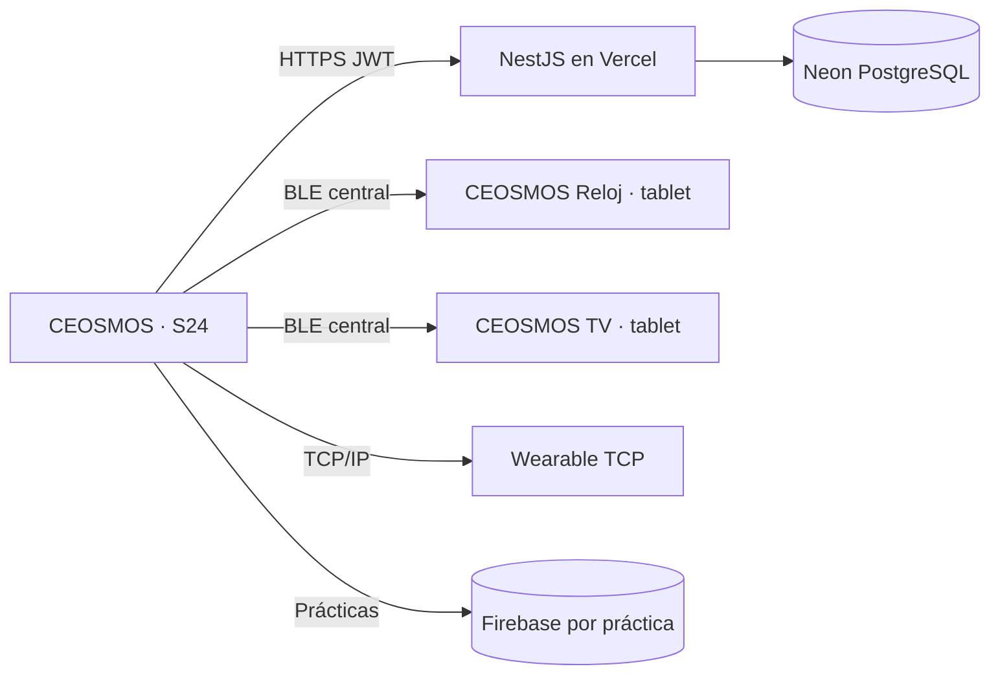

# Arquitectura y stack

| Capa | Tecnología (confirmada en el código) |
| --- | --- |
| App móvil | Flutter 3.41.9 / Dart 3.11.5, `AppState` (ChangeNotifier), paquete `com.ceosmos.ceosmos_movil_integral` |
| Android | AGP 8.11.1, Kotlin 2.2.20, Java 17, Compose (P9/P10) |
| BLE central | `flutter_blue_plus` 2.3 (licencia nonprofit) detrás de `BleTransporte` (`lib/core/ble/`) |
| Apps compañeras | `companion/` (Kotlin + Compose), sabores `reloj`, `tv`, `companion` |
| API | NestJS 11 + Prisma 5 (`WEBANGULAR/ceosmos-api`, rama `movil-integral`), en Vercel (`ceosmos-api.vercel.app`) |
| BD | PostgreSQL en Neon (producción); PostgreSQL 16 local en `.devdb` (puerto 5433) para pruebas |
| Correo | Resend, remitente `noreply@ceosmos.online` |
| Prácticas | Firebase (5 apps con nombre), SQLite (Floor), SharedPreferences, API Node de MediConnect (HTTPS 3443 con certificado fijado) |

## Cómo se compila y ejecuta
- App contra producción: `flutter build apk --release --dart-define=CEOSMOS_API_URL=https://ceosmos-api.vercel.app/api`.
- Contra la API local: `bash p11yp12/p12/scripts/api_local.sh <log>` (+ PostgreSQL de `.devdb`), app con `CEOSMOS_API_URL=http://localhost:8080/api` y `adb reverse tcp:8080 tcp:8080`.
- Compañeros: `cd companion && ./gradlew assembleRelojDebug assembleTvDebug` (JAVA_HOME = JBR de Android Studio).
- Automatización por adb: `scripts/ui.sh` (toca por texto con `uiautomator`).

## Comportamientos que conviene recordar
- La API permite **una sesión por usuario**: entrar en otro equipo cierra la anterior (no es fallo).
- Desde la red del usuario el puerto 5432 de Neon está bloqueado; las migraciones van por WebSocket (`prisma/migrate-ws.js`).
- Cada push a `movil-integral` redespliega en Vercel y corre `prisma migrate deploy` contra Neon.
- El aviso de FlutterSecureStorage «Falling back to custom ciphers» es normal.
- Huawei HiSuite instala un adb viejo (`hwtransport.exe`, 1.0.39) que pelea con el de Android SDK: se desinstaló el 18/11.

---
Navegación: [[00 - Índice CEOSMOS]] · [[04 - Módulos de la app]] · [[06 - BLE Wearable y TV]] · [[09 - Decisiones técnicas]]
