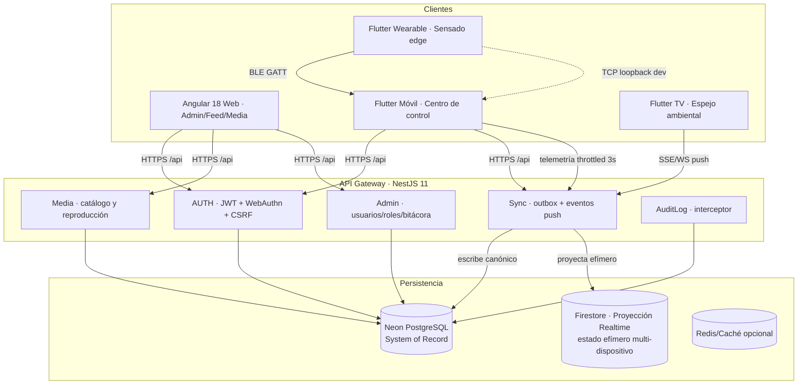

> [!warning] Nota histórica (anterior a la integración del 11/11/2026). Describe otros repositorios y propuestas; donde contradiga al código actual, gana el código. Ver [[09 - Decisiones técnicas]] y [[00 - Índice CEOSMOS]].

# Arquitectura - CEOSMOS Integral

# Documento de Arquitectura Integral — Fusión del Ecosistema CEOSMOS

**Versión:** 1.0 — 2026-09-20
**Estado:** Propuesta arquitectónica oficial
**Alcance:** Fusión de CEOSMOS WEB (Angular 18 + NestJS 11 + Neon), CEOSMOS DDI (Flutter móvil/wearable/TV + Firestore) y CEOSMOS PWA vanilla legada, bajo una sola plataforma unificada.

---

## Fuentes

- [[Histórico - CEOSMOS Web (auditoría)]] — Reporte de auditoría de CEOSMOS WEB (Angular 18 + NestJS 11 + Neon).
- [[Histórico - CEOSMOS Flutter (auditoría)]] — Reporte de auditoría del ecosistema CEOSMOS móvil / wearable / TV (Firestore y sincronización realtime).
- Esta arquitectura se rige por las normas definidas en «Reglas-Clean-Code» (nota de la bóveda anterior, no se conservó).
- Nodo de entrada a la bóveda: hoy [[00 - Índice CEOSMOS]] (antes «00-Dashboard»).

---

## 1. Propósito y Alcance

Este documento define la arquitectura técnica objetivo para fusionar los tres silos actuales del ecosistema CEOSMOS en **una sola plataforma**, resolviendo:
1. La **duplicidad de UI** (múltiples superficies compitiendo por la misma función).
2. El **conflicto de persistencia** entre **Neon (PostgreSQL)** —usado por CEOSMOS WEB— y **Cloud Firestore** —usado por CEOSMOS DDI—.
3. La convivencia de **Angular** (web), **NestJS** (API/backend) y **Flutter** (móvil, wearable y TV) bajo una única fuente de verdad.

**No es una reescritura:** es una **orquestación de lo existente** alrededor de un núcleo API-first, transformando la duplicidad en responsabilidades bien delimitadas.

---

## 2. Diagnóstico: el ecosistema actual (tres islas)

| Superficie | Stack | Datos | Rol actual | Problemas detectados en auditoría |
| :--- | :--- | :--- | :--- | :--- |
| **CEOSMOS WEB** | Angular 18 (Signals) + NestJS 11 + Prisma | Neon (PostgreSQL) | Cuenta, auth (JWT+WebAuthn), admin, media, tareas, auditoría | `.env` commiteado; `any` en auth; 22+ `console.log`; feed hardcodeado sin conectar a `MediaItem`; 3 servicios de búsqueda duplicados |
| **CEOSMOS Móvil** | Flutter + Firebase Auth | Firestore | Centro de control; gateway BLE/TCP; throttling de telemetría 3s | BLE bypassed por TCP; mini-player duplicado; `HistorialScreen` huérfana; reglas Firestore permisivas |
| **CEOSMOS Wearable** | Flutter (GATT server + TCP) | — (edge) | Sensado simulado y comandos multimedia | GATT no conectado; estados inconsistentes UI/provider |
| **CEOSMOS TV** | Flutter Web (`dart:html`) | Firestore (`sesiones/{uid}`, `vinculaciones/{codigo}`) | Espejo ambiental con D-pad | `dart:html` impide Android TV nativo; `DashboardTvScreen` >500 líneas |

**Conclusión del diagnóstico:** la mayor fortaleza del ecosistema es la **arquitectura de sincronización reactiva ya probada** (móvil → bridge throttled → nube → TV con `snapshots()`). La mayor debilidad es que **no existe un contrato único de datos**: cada superficie define su propio esquema (Neon vs Firestore) y su propia navegación.

---

## 3. Arquitectura Objetivo: Plataforma Unificada API-First

### 3.1 Principios rectores (derivados de `Ingenieria_y_Reglas/`)

1. **Single Source of Truth:** cada agregado de datos tiene **un solo dueño de escritura canónico**.
2. **API-first:** todo dato que no sea telemetría efímera pasa por la API de NestJS. Ningún cliente escribe directamente en la BD canónica.
3. **Rol único por tecnología:** Unity/WebGL renderizan; Flutter mueve la UI móvil; Angular administra; NestJS gobierna los datos.
4. **Cero secretos en el repositorio, cero `any`, cero `console.log` en producción** (Reglas Clean Code vigentes).
5. **Sin fallback silencioso**: los estados de error son visibles y explícitos (Antipatrones vigentes).
6. **Un solo sistema de diseño:** los tokens "Cosmos" (ya definidos) son el contrato visual de todas las superficies.

### 3.2 Diagrama de componentes objetivo

### 3.3 Cómo conviven Angular, NestJS y Flutter

| Capa | Responsabilidad | Tecnología | Interacción |
| :--- | :--- | :--- | :--- |
| **Web (Angular 18)** | Console de administración, feed, gestión de media y preferencias. Autenticación con JWT httpOnly + passkeys. | Angular 18 standalone + Signals + PrimeNG | Consume solo `/api/*` (vercel rewrite proxy → Railway). Nunca toca Firestore. |
| **API (NestJS 11)** | Único guardián de la BD canónica (Neon): auth, media, admin, audit, search, tasks. Emite eventos de cambio (SSE/WebSocket). | NestJS 11 + Prisma 5 + Neon | Escribe en PostgreSQL; publica proyecciones realtime para los clientes reactivos. |
| **Móvil (Flutter)** | Centro de control personal: recoge telemetría del wearable (BLE primario, TCP dev), la consolida con throttling de 3s y la envía por API; además lee el catálogo de media vía API. | Flutter + Provider | **Doble canal:** datos canónicos por `/api`; estado de sesión activo proyectado en Firestore para espejos. |
| **TV (Flutter Web → nativo)** | Espejo ambiental: refleja la sesión activa, salud y reproducción con navegación D-pad. | Flutter Web (migrado sin `dart:html`) | **Solo lectura reactiva** vía proyección realtime + eventos push. |
| **Wearable (Flutter)** | Sensado edge + comandos multimedia. Sin persistencia propia. | Flutter + `ble_peripheral` | Envía telemetría al móvil (canal local); no habla con la nube. |

---

## 4. Resolución de Duplicidades de UI

### 4.1 Principio: Autoridad Única por Superficie

| Función | Autoridad canónica | Se elimina |
| :--- | :--- | :--- |
| Navegación principal | **Móvil** (BottomNav) / **Web** (sidebar admin) | Drawers y menús duplicados (ej. canciones `_ReproductorMusical` vs `MiniPlayer`) |
| Reproducción de audio | **Un solo reproductor global por cliente** (`MiniPlayer` en móvil; `PlayerComponent` en web) | `_ReproductorMusical` embebido en `SeleccionModoScreen` |
| Búsqueda | **Un solo `SearchService`** con contrato único (operar backend, estado vacío real) | 3 servicios de búsqueda paralelos |
| Gestión de sesión | **NestJS /auth + Sessions en BD** | Lógica de auth duplicada en TV/móvil (quedan como clients del ApiGateway) |
| Gestión de media | **Web (admin) + catálogo servido por API** | Feed hardcodeado en memoria (`FeedDataService`) → se conecta a `MediaItem` |

### 4.2 Sistema de diseño único: Tokens "Cosmos"

- Las tokens ya definidas (`--cosmos-deep-space`, `--cosmos-nebula`, `--cosmos-aurora`, etc.) se formalizan en un **paquete de diseño compartido** consumido por:
  - Angular: CSS custom properties globales (`:root`).
  - Flutter: `CosmosTheme` (ya existe en `movil/lib/theme`) extendido a `tv` y `wearable`.
- **Regla:** ningún componente nuevo hardcodea colores, radios (8/12/16/24) o tipografías (Inter / Space Grotesk) fuera de este contrato.

### 4.3 Limpieza de huérfanos y monolíticos

- `HistorialScreen` (móvil): enlazarla desde `PerfilScreen` o purgarla.
- `DashboardTvScreen` (>500 líneas): dividir en `TvAudioController`, `TvDpadHandler`, `widgets/` (pestañas Home/Conexión/Salud).
- Carpetas vacías `backend/` y `shared/` del monorepo WEB: eliminarlas o definirlas con propósito real (el paquete compartido de diseño vive en `shared/`).

---

## 5. Resolución de Conflictos de Base de Datos (Neon vs Firestore)

### 5.1 Modelo de propiedad de datos (Single-Writer)

La regla que elimina el conflicto: **cada agregado tiene UN dueño canónico de escritura**.

| Agregado | Dueño canónico | Almacén | Proyección / Replica |
| :--- | :--- | :--- | :--- |
| Usuario, credenciales, roles, sesiones | **NestJS** | Neon (PostgreSQL) | — (leído vía API) |
| Passkeys (WebAuthn) | **NestJS** | Neon | — |
| Catálogo `MediaItem`, tareas, preferencias | **NestJS** | Neon | Catálogo cacheado por clientes; cambio publicado por eventos |
| `AuditLog` | **NestJS** (interceptor) | Neon | — |
| Sesión activa `{uid}` (modo, métricas, pista) | **Móvil** (única app que escribe telemetría) | Firestore proyección | TV escucha `snapshots()` (read-only) |
| Vinculación PIN `{codigo}` | **Móvil** (genera) / **TV** (reclama con transacción) | Firestore efímero | TTL 10 min como hoy |
| Historial / Favoritos del usuario | **NestJS** (migrar de subcolecciones Firestore) | Neon | — |

### 5.2 Estrategia de sincronización (evita dobles escrituras y LWW tóxico)

1. **Datos canónicos → una sola puerta:** toda creación/modificación pasa por la API. El backend escribe en Neon y **publica un evento de dominio** (`SyncGateway`).
2. **Proyección realtime (Firestore):** solo el `SyncGateway` de NestJS (o un worker autorizado) escribe la proyección de estado efímero en Firestore mediante **fuentes de datos fusionadas** (`set` con `merge`), nunca por doble escritura manual del cliente.
3. **Telemetría móvil:** el `FirebaseDataBridge` (throttling 3s) permanece como *único escritor de métricas* sobre `sesiones/{uid}`; la TV consume con `snapshots()` en **solo lectura** (las reglas de Firestore se endurecen: `allow read: if request.auth != null && request.auth.uid == uid`).
4. **Push hacia clientes web:** SSE/WebSocket desde NestJS → Angular para notificaciones en tiempo real (estado de sesión, alertas). Elimina la necesidad de polling.
5. **Outbox pattern:** las mutaciones canónicas que deban reflejarse en Firestore se encolan (tabla `outbox_events` en Neon) y un worker las aplica de forma idempotente y reproducible (transacción + `event_id` únicos).

### 5.3 Manejo de conflictos

- **Sin last-write-wins silencioso:** todo documento proyectado en Firestore incluye `schemaVersion` y `updatedBy` para trazabilidad.
- **Regla de convergencia:** si un cliente detecta una proyección divergente del canónico, **descarta la proyección** y refresca desde la API (la proyección es cache, no verdad).
- Los campos de sesión activa solo los escribe el móvil; si la TV necesita modificar estado (pausar música → comando), el comando viaja por **API** (o canal local móvil↔wearable), no escribiendo Firestore.

---

## 6. Seguridad y Secretos (aplicando Reglas Clean Code)

1. **Rotación inmediata de credenciales** (JWT_SECRET, DATABASE_URL de Neon, RESEND_API_KEY) tras el incidente del `.env` commiteado.
2. `.env` en `.gitignore` raíz; `github-actions` con pre-commit scanner de secretos.
3. **Reglas Firestore endurecidas:** reemplazar los `allow read, write: if true;` por reglas de ownership (`request.auth.uid == uid` para `sesiones/{uid}`, solo lectura para TV).
4. Mantener: JWT httpOnly cookie + CSRF double-cookie + bruteforce lock + CSP en la PWA/TV + Helmets en NestJS.
5. Cero secreto en clientes móviles: `firebase_config` en runtime seguro (ya gitignored en TV), API keys de Firebase por paquete.

---

## 7. Hoja de Ruta de Migración

### Fase 0 — Higiene crítica (1-2 semanas)
- Rotar secretos; limpiar historial Git; gate de CI con scanner de secretos.
- Eliminar `console.log` (22+), botón `🧪 Buscar "nature"`, y los `any` de auth (reglas Clean Code).
- Endurecer reglas Firestore (ownership + read-only TV).

### Fase 1 — Consolidar el contrato de datos (3-4 semanas)
- Definir SDK de contratos compartidos (DTOs/`types` en `shared/`): `UserDto`, `SessionDto`, `MediaItemDto`, `TelemetryDto`.
- Conectar el feed web a `MediaItem` (eliminar feed hardcodeado).
- Migrar historial/favoritos móviles de subcolecciones Firestore → Neon vía API.
- Implementar `SyncGateway` + tabla `outbox_events`.

### Fase 2 — Unificar UI y superficies (3-4 semanas)
- Aplicar autoridad única de reproducción y búsqueda (móvil y web).
- Refactorizar `DashboardTvScreen`; eliminar `dart:html` (migrar a `shared_preferences`).
- Compartir tokens "Cosmos" como paquete (`shared/design-tokens`).
- Enlazar/purgar pantallas huérfanas.

### Fase 3 — Realtime y TV nativa (2-3 semanas)
- SSE/WebSocket NestJS → Angular para notificaciones y espejo de sesión.
- Evaluar Android TV nativo (una vez sin `dart:html`).
- Reconectar BLE primario en el móvil (GATT) con TCP dev como fallback condicional.

### Fase 4 — Hardening y pruebas (continua)
- Suite E2E (auth, admin, CSRF); tests unitarios para bridge/throttling y providers.
- Observabilidad: `AuditLog` completo (`targetId`), logging con `Logger` de NestJS.

---

## 8. Criterios de Aceptación (Definition of Done del ecosistema)

1. Un usuario puede registrarse en web y **usar la misma cuenta** en móvil y TV (Neon como fuente única).
2. Métricas del wearable → móvil → nube → TV en < 5 s sin escritura manual (proyección realtime).
3. **Cero** escrituras directas de clientes a tablas canónicas de Neon.
4. **Cero** `.env`, `any` y `console.log` en producción (gates de CI verdes).
5. Una sola barra de reproducción visible en cada superficie.
6. Reglas Firestore validan ownership del usuario; TV es read-only.

---

## 9. Riesgos y Mitigaciones

| Riesgo | Impacto | Mitigación |
| :--- | :--- | :--- |
| Migrar historial/favoritos rompe datos existentes | Medio | Migración por lotes con backfill + validación de conteos antes/después |
| Proyección Firestore desincronizada por fallo del worker | Medio | Outbox idempotente + reconciliador periódico (canónico → proyección) |
| Reintroducir `dart:html` en TV | Alto | Gate CI con `grep` en `flutter analyze` |
| Doble fuente de verdad durante la transición | Alto | Congelar escrituras directas a Firestore en Fase 1; todo flujo nuevo vía API |
| Regresión en sincronización en vivo | Alto | Mantener `FirebaseDataBridge` intacto como escritor único de métricas durante las fases; agregar integration tests de latency |