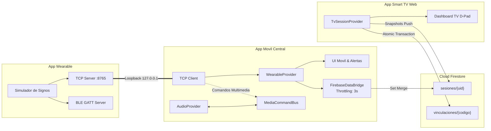

> [!warning] Nota histórica (anterior a la integración del 11/11/2026). Describe otros repositorios y propuestas; donde contradiga al código actual, gana el código. Ver [[09 - Decisiones técnicas]] y [[00 - Índice CEOSMOS]].

# Memoria Histórica - CEOSMOS Flutter

# Reporte de Auditoría de Código Senior: Ecosistema CEOSMOS

**Fecha de Auditoría:** 20 de Septiembre de 2026
**Ámbito del Proyecto:** Ecosistema Multi-dispositivo CEOSMOS (`movil`, `wearable`, `tv`)
**Repositorio Analizado:** `ceosmos-dispositivos-inteligentes`

---

## 1. Arquitectura y Tecnologías

### 1.1 Estructura Real del Repositorio
El repositorio no es una sola aplicación monolítica, sino un **monorepositorio desacoplado** compuesto por 3 proyectos independientes de Flutter/Dart:

```text
ceosmos-dispositivos-inteligentes/
├── README.md                      # Documentación general de despliegue
├── Evidencia/                     # Directorio de evidencias (reporte/.gitkeep)
├── movil/                         # Aplicación Móvil Principal (Flutter)
│   ├── android/ & ios/            # Plataformas nativas con google-services.json
│   ├── firestore/                 # firestore.rules y seed_contenidos.json
│   ├── scripts/                   # seed_contenidos.js (Script Node de migración)
│   ├── test/                      # widget_test.dart (Boilerplate)
│   └── lib/
│       ├── main.dart              # Punto de entrada, AuthGate, MainScaffold
│       ├── ble/                   # ble_service, ble_constants, tcp_fallback_client
│       ├── models/                # Contenido, Favorito, Historial, Sesión, WearableData
│       ├── providers/             # Audio, Auth, Historial, Sesión, Wearable
│       ├── screens/               # Modos, Dispositivos, Salud, Perfil, Login, Registro, etc.
│       ├── services/              # AuthService, FirestoreService, FirebaseDataBridge, MediaBus
│       ├── theme/                 # CosmosTheme (Glassmorphism, gradientes y fuentes)
│       └── widgets/               # MiniPlayer
├── wearable/                      # Aplicación para Reloj / Simulador Wearable (Flutter)
│   ├── android/ & ios/
│   ├── test/                      # widget_test.dart (Boilerplate)
│   └── lib/
│       ├── main.dart              # Entrypoint Wearable
│       ├── ble/                   # gatt_server_service, ble_constants
│       ├── models/                # wearable_data_model
│       ├── providers/             # wearable_gatt_provider
│       ├── screens/               # wearable_home_screen (UI circular smartwatch)
│       └── services/              # simulador_datos_service, tcp_server_service
└── tv/                            # Aplicación para Smart TV (Flutter Web / PWA)
    ├── web/ & test/
    └── lib/
        ├── main.dart              # Entrypoint TV con captura global de D-Pad / Atajos
        ├── config/                # firebase_options.dart, theme.dart
        ├── providers/             # tv_session_provider (Transacciones y sincronización)
        ├── screens/               # dashboard_tv_screen, login_tv_screen
        └── widgets/               # focusable_glass_card, tv_pin_field, tv_text_field
```

> [!WARNING]
> **Discrepancia Documental Crítica**: El archivo `README.md` documenta que `tv/` es una *"PWA estática: HTML/CSS/JS + Firebase"*. **Esto es incorrecto con respecto al código real**: el directorio `tv/` fue desarrollado en **Flutter Web** (`tv/pubspec.yaml`), con soporte de renderizado en Canvas/HTML, navegación por teclado D-pad y widgets personalizados.

### 1.2 Stack Tecnológico Exacto
- **Lenguaje & SDK:** Dart (SDK `^3.11.5`) / Flutter Framework.
- **Gestor de Estado:** `provider: ^6.1.5+1` implementado transversalmente (`ChangeNotifierProvider`, `ChangeNotifierProxyProvider`, `Consumer`, `context.watch`/`read`).
- **Backend y BaaS:**
  - `firebase_core: ^4.12.1` / `^4.13.0`
  - `cloud_firestore: ^6.7.1` / `^6.8.0`
  - `firebase_auth: ^6.5.7` (en `movil`)
- **Hardware & Red:**
  - `flutter_blue_plus: ^2.3.11` (Cliente BLE central en `movil`).
  - `ble_peripheral: ^2.4.0` (Servidor GATT peripheral en `wearable`).
  - `dart:io` (`Socket`, `ServerSocket` en `127.0.0.1:8765`) como fallback TCP inter-proceso.
- **Audio & Multimedia:**
  - `just_audio: ^0.9.36` (reproducción local en móvil y remota por streaming en TV).
  - `file_picker: ^11.0.3` (exploración recursiva del sistema de archivos local en móvil).
- **Fuentes & Estilos:** `google_fonts: ^8.2.1` (`Space Grotesk`, `Inter`).
- **Consumo HTTP:** `http: ^1.2.0` (API de citas motivacionales en TV).
- **Almacenamiento Local:** `shared_preferences: ^2.5.5` / `^2.2.3` y `dart:html` (`window.localStorage` en TV).

### 1.3 Patrones de Diseño Identificados
- **Provider / Observer Pattern:** Reactividad pura entre estado y UI. En `movil`, `SesionProvider` e `HistorialProvider` se encadenan al `AuthProvider` mediante `ChangeNotifierProxyProvider` para recargar datos automáticamente según el UID autenticado.
- **Data Bridge / Throttle Pattern:** `FirebaseDataBridge` implementa un acumulador temporal en memoria que solo persiste hacia Firestore una muestra cada 3 segundos, evitando rate-limits y costos excesivos de escritura.
- **Event Bus Pattern:** `MediaCommandBus` desacopla eventos de reproducción multimedia que llegan desde el socket TCP del wearable hacia el reproductor del móvil.
- **Service-Repository Pattern:** Abstracción de llamadas en servicios dedicados (`AuthService`, `FirestoreService`, `GattServerService`, `TcpServerService`).
- **Dual-Channel Fallback:** Soporte de comunicación por BLE como canal nominal, y TCP Loopback (`127.0.0.1:8765`) como canal de contingencia para pruebas locales.

---

## 2. Bases de Datos y Backend

### 2.1 Motor de Base de Datos Real
- **Motor:** **Google Cloud Firestore** (NoSQL orientado a documentos).
- **Identificador de Proyecto Firebase:** `ceosmos-movil` (Número de proyecto: `706025320854`).
- **Autenticación:** Firebase Authentication (Email y contraseña).

### 2.2 Estructura de Colecciones y Esquemas en Firestore

| Colección / Ruta | Tipo de Acceso | Esquema de Campos | Propósito |
| :--- | :--- | :--- | :--- |
| `contenidos/{contenidoId}` | Colección raíz (Lectura pública) | `modo` (String), `titulo` (String), `tipoContenido` (String), `colorAcento` (Hex String), `colorSecundario` (Hex String), `iconoNombre` (String), `fondoUrl` (String), `audioUrl` (String) | Catálogo maestro de modos (ej. *Bosque en calma*, *Lofi enfocado*, *Frases de impulso*, *Piano ambiental*). |
| `sesiones/{uid}` | Documento por usuario | `modoActual` (String), `contenidoId` (String), `estado` ('activa' \| 'finalizada'), `inicioTimestamp` (Timestamp), `frecuenciaCardiaca` (Number), `pasos` (Number), `estadoSalud` (String), `ultimaActualizacion` (ServerTimestamp), `pistaActual` (String?), `reproduciendo` (Boolean) | **Punto neurálgico de sincronización en tiempo real.** Móvil escribe métricas; TV escucha mediante `snapshots()` (push reactivo). |
| `vinculaciones/{codigo}` | Colección raíz efímera | `uid` (String), `email` (String), `creadoEn` (ServerTimestamp), `expiraEn` (Timestamp, 10 min), `usado` (Boolean) | Enlace PIN de 6 dígitos entre app Móvil y Smart TV. |
| `usuarios/{uid}/historial/{id}` | Subcolección privada | `id` (String), `modoActual` (String), `inicio` (Timestamp), `fin` (Timestamp), `duracionSegundos` (Number), `frecuenciaMax` (Number), `estado` (String) | Histórico de sesiones cerradas del usuario. |
| `usuarios/{uid}/favoritos/{id}` | Subcolección privada | `contenidoId` (String), `fechaAgregado` (Timestamp) | Modos marcados como favoritos por el usuario. |

### 2.3 Reglas de Seguridad (`firestore.rules`)
Las reglas actuales desplegadas son **permisivas y de desarrollo**:
- `match /contenidos/{doc}`: `allow read: if true; allow write: if false;`
- `match /sesiones/{uid}`: `allow read, write: if true;` *(sin validación de `request.auth.uid`)*
- `match /vinculaciones/{codigo}`: `allow read: if resource == null || resource.data.expiraEn > request.time; allow write: if true;` *(seguridad temporal por expiración)*
- `match /usuarios/{uid}/**`: `allow read, write: if true;`

### 2.4 Endpoints y APIs Externas
1. **Firebase Auth REST / SDK:** Login y registro de usuarios (`signInWithEmailAndPassword`, `createUserWithEmailAndPassword`).
2. **Quotable API (`https://api.quotable.io/random`):** Consumida vía HTTP GET por la TV con timeout de 3 segundos para mostrar citas motivacionales en el modo de inspiración. Cuenta con un array de frases en memoria como fallback en caso de error o sin conexión.

---

## 3. Estado de Avance del Código

### 3.1 Componentes y Pantallas Terminadas y Operativas
- **Módulo Móvil (`movil`):**
  - `LoginScreen` y `RegistroScreen`: Validación de formularios, manejo de errores de autenticación con Firebase.
  - `AuthGate`: Enrutador condicional reactivo que conmuta entre login y el scaffold principal.
  - `SeleccionModoScreen`: Fondo dinámico con gradiente reactivo que transiciona según el modo activo; carrusel horizontal de sugerencias y GridView de modos desde Firestore.
  - `SaludScreen`: Métricas en vivo (FC, Pasos, Estado), lógica de alertas críticas si FC > 110 bpm y tarjetas de recomendación según estado psicofisiológico.
  - `DispositivosScreen`: Generador de PIN criptográficamente seguro (`Random.secure()`) de 6 dígitos con expiración a 10 min, contador regresivo en vivo y monitoreo reactivo de vinculación con la TV.
  - `PerfilScreen`: Información del usuario en sesión y acción de logout.
  - `AudioProvider`: Escaneo local de audio con `file_picker` en múltiples formatos (.mp3, .wav, .aac, etc.) y control de playlist.
  - `FirebaseDataBridge`: Mecanismo anti-spam con throttling de 3s para subir telemetría del reloj a la nube.
- **Módulo Wearable (`wearable`):**
  - `SimuladorDatosService`: Generador autónomo de métricas cardíacas (60-140 bpm), acumulación de pasos y derivación de estados (`flow`, `estres`, `normal`, `pausa`).
  - `WearableHomeScreen`: Interfaz gráfica circular adaptada a smartwatch (o tablet enmascarada), con swipe horizontal (`PageView`), métrica rotativa animada cada 3s (`_MetricaRotativa`) y pantalla de control de música remota.
  - `TcpServerService`: Socket TCP local para transferir telemetría y recibir comandos de reproducción.
- **Módulo Smart TV (`tv`):**
  - `main.dart`: Configuración de atajos de teclado y captura de teclas de cursor (`LogicalKeyboardKey.arrow*`, `enter`, `select`) para navegación por control remoto (D-Pad).
  - `DashboardTvScreen`: Pestañas *Home*, *Conexión* y *Salud*, tarjetas con efecto hover/focus (`FocusableGlassCard`), streaming de audio y modal de inspiración.
  - `LoginTvScreen`: Formulario con navegación por foco para ingresar correo y PIN de 6 dígitos.
  - `TvSessionProvider`: **Transacción atómica en Firestore** (`runTransaction`) para reclamar el PIN de vinculación evitando condiciones de carrera, y escucha reactiva del documento del usuario.

### 3.2 Componentes a Medias, Inconsistentes o Fallando
1. **Bypass del BLE en la App Móvil (Código Muerto):**
   - El archivo `movil/lib/ble/ble_service.dart` está completamente implementado con `flutter_blue_plus`, pero `WearableProvider.conectar()` **ignora `BleService` por completo** y solo llama a `TcpFallbackClient` en `127.0.0.1:8765`.
2. **Inconsistencia de Estados en `MonitoreoWearableScreen` (Bug de UI):**
   - En `monitoreo_wearable_screen.dart` (L44-L51), los botones se muestran según si el estado es `'inactivo'`, `'buscando'` o `'conectado_respaldo'`.
   - Sin embargo, `WearableProvider` emite exclusivamente `'desconectado'`, `'conectando'`, `'conectado'` o `'error'`.
   - **Consecuencia:** Cuando la app inicia en estado `'desconectado'`, la pantalla no muestra ningún botón para conectar o buscar el dispositivo.
3. **Pantalla Huérfana (`HistorialScreen`):**
   - `historial_screen.dart` está programada pero **no está accesible desde ningún menú**, barra de navegación inferior (`MainScaffold`) ni ruta de navegación.
4. **Módulo de Favoritos Incompleto:**
   - `HistorialProvider` tiene soporte para persistir y consultar favoritos en Firestore, pero ninguna vista de la app móvil contiene botones o listas para interactuar con ellos.
5. **Script de Inicialización de Datos Roto:**
   - `seed_contenidos.js` (L21) intenta importar `tv/js/firebase-config.js` (un remanente de una versión previa en HTML/JS), el cual no existe en el repositorio.
6. **Tests Unitarios y de Integración Rotos:**
   - Los 3 proyectos (`movil`, `wearable`, `tv`) mantienen el archivo por defecto `widget_test.dart` generado por Flutter (la prueba del contador numérico). Si se ejecuta `flutter test`, **las pruebas fallan de inmediato** en los tres proyectos.

---

## 4. Deuda Técnica y Antipatrones

### 4.1 Antipatrones de Arquitectura y Escalabilidad
- **Superposición de Reproductores Multimedia (Conflicto de UI):**
  - En `movil/lib/main.dart` (L228-L233) se monta un `MiniPlayer` permanente anclado al final del `Stack`.
  - Simultáneamente, dentro de `SeleccionModoScreen` (L149) se renderiza otro reproductor (`_ReproductorMusical`).
  - Cuando se reproduce música, **ambos reproductores compiten visualmente**, tapándose el uno al otro.
- **Dependencia Rígida de Web en la App TV (`dart:html`):**
  - En `tv/lib/providers/tv_session_provider.dart` (L2), se importa `dart:html` directamente para acceder a `html.window.localStorage`.
  - Esto impide compilar el proyecto TV como una app Android TV nativa (.apk) en el futuro, forzándolo a ejecutarse exclusivamente como Web. Debería reemplazarse por `shared_preferences`.
- **Falta de Segregación en `DashboardTvScreen` (Clase Monolítica):**
  - `dashboard_tv_screen.dart` sobrepasa las 500 líneas y mezcla en una sola clase: ciclo de vida del reproductor de audio, peticiones HTTP directas a APIs externas, lógica de atajos D-Pad y construcción de widgets de tres pantallas distintas.
- **Manejo Silencioso de Errores:**
  - En servicios como `FirestoreService`, los bloques `catch` capturan excepciones con `print()` simple y no propagan el error ni emiten un estado de falla hacia los providers o la UI.

---

## 5. Contexto de Negocio: CEOSMOS Móvil Integral

El sistema está concebido como una plataforma de **bienestar psicofisiológico y concentración inmersiva en tiempo real**. El ecosistema opera de la siguiente manera:



### 5.1 Estructura Visual y Feeds
- **Móvil:** Adopta una estética espacial (*Deep Space*, *Nebula*, *Stardust*). Cuando el usuario activa un modo de concentración (ej. *Bosque en calma* o *Lofi enfocado*), un `AnimatedContainer` adapta suavemente los gradientes de toda la interfaz. Incluye un banner reactivo superior de sesión activa y un mini-reproductor flotante.
- **Wearable:** El feed se presenta recortado en un círculo perfecto (`diametro = lado * 0.90`) para emular la esfera de un reloj inteligente sobre fondo negro OLED. Su elemento central es una métrica animada (`AnimatedSwitcher`) que rota automáticamente cada 3 segundos entre Frecuencia Cardíaca (BPM), Pasos y Estado (`FLOW`, `ESTRÉS`, `NORMAL`).
- **Smart TV:** Diseñada para visualización a distancia (interfaz de 10 pies), cursor de mouse ocultado deliberadamente (`SystemMouseCursors.none`) y navegación mediante foco con bordes iluminados dorados/aurora (`FocusableGlassCard`).

### 5.2 Sincronización Inter-dispositivo
1. **Wearable → Móvil:** El reloj emite telemetría por TCP (`{"frecuenciaCardiaca": 85, "pasos": 120, "estado": "flow"}`) cada segundo. Además, el reloj puede enviar comandos multimedia remotos (`{"type": "media_control", "action": "play_pause"}`), que el móvil captura a través del `MediaCommandBus` para pausar o adelantar las canciones locales.
2. **Móvil → Cloud Firestore:** El móvil actúa como gateway. Para no saturar Firestore (límite de 1 escritura/seg por documento y costos de cuota), el `FirebaseDataBridge` almacena la última muestra y la consolida cada 3 segundos en el documento `sesiones/{uid}`.
3. **Móvil ↔ Smart TV:**
   - La TV se empareja mostrando una pantalla donde se ingresa el PIN de 6 dígitos que genera el móvil.
   - La TV procesa la vinculación mediante una transacción en Firestore que invalida el PIN de inmediato (`usado: true`).
   - Una vez vinculada, la TV abre un canal reactivo (`snapshots()`) a `sesiones/{uid}` sin hacer polling. Tan pronto como el móvil escribe los datos de salud o el modo musical seleccionado, la pantalla grande refleja el ritmo cardíaco, nivel de estrés y música de manera sincronizada.

---

## 6. Recomendaciones de Acción Prioritarias

1. **Resolver el estado del BLE:** Si el objetivo es que el wearable sea un dispositivo físico independiente, conectar formalmente `BleService` a `WearableProvider` con reconexión automática, dejando TCP únicamente como fallback condicional.
2. **Corregir bug en `MonitoreoWearableScreen`:** Homogeneizar los strings de estado (`'desconectado'`, `'conectando'`, `'conectado'`, `'error'`) para que los botones de vinculación funcionen.
3. **Limpiar UI de Audio:** Remover `_ReproductorMusical` de `SeleccionModoScreen` y conservar el `MiniPlayer` global de `MainScaffold` para evitar la colisión de dos barras de reproducción en pantalla.
4. **Enlazar `HistorialScreen`:** Agregar un acceso al historial (por ejemplo, desde el `AppBar` de `PerfilScreen` o una nueva opción) o purgar el archivo si no es parte del alcance.
5. **Reemplazar `dart:html` en la TV:** Migrar `html.window.localStorage` a `shared_preferences` para permitir compatibilidad multiplataforma y despliegues nativos en Android TV.
6. **Implementar Suites de Pruebas Reales:** Eliminar los tests de muestra del contador y redactar pruebas unitarias para `FirebaseDataBridge`, `WearableDataModel` y los proveedores de estado.