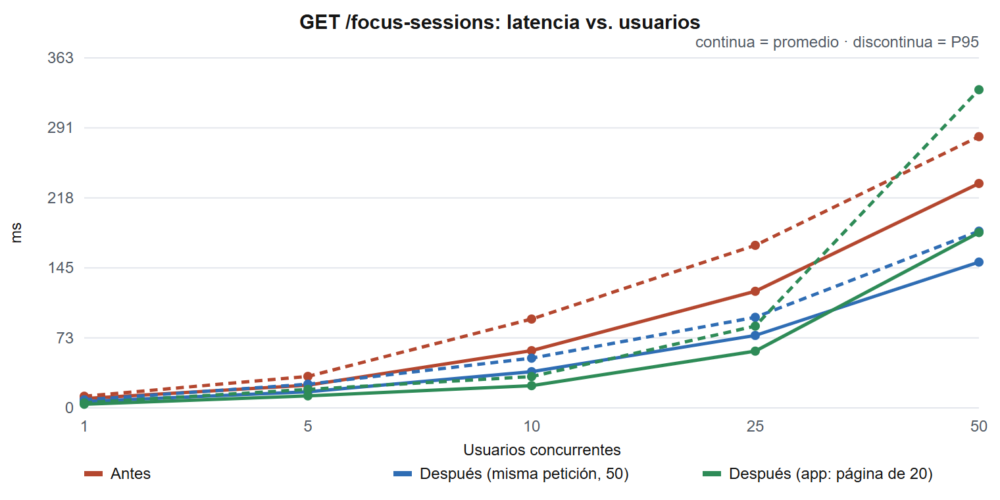
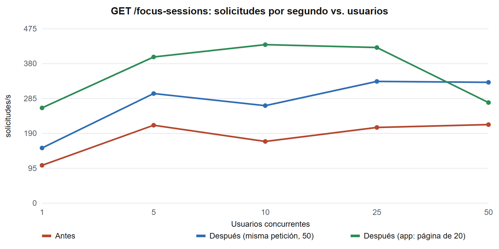
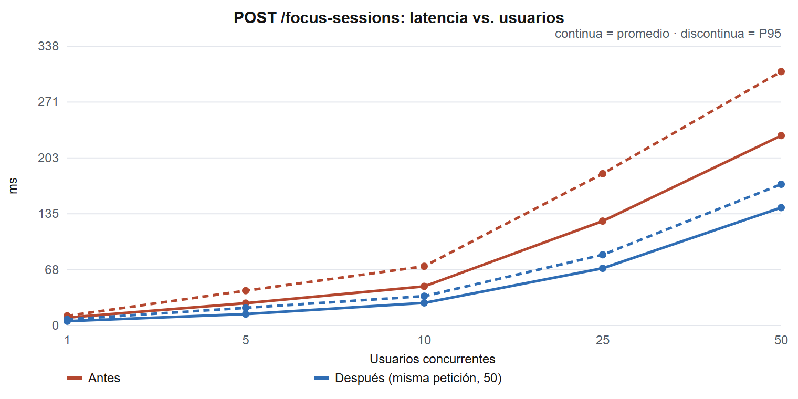

# Práctica 12 · Optimización, pruebas de estrés y resiliencia de CEOSMOS Móvil Integral

**Proyecto:** CEOSMOS Móvil Integral (app Flutter + API NestJS/Prisma + PostgreSQL)
**Fecha de ejecución:** 12 de noviembre de 2026, 00:05 – 07:30 (hora del centro de México)
**Punto de partida:** el reporte de la Práctica 11 (`p11yp12/p11/REPORTE_P11_WHITEBOX.md`), con sus 9 defectos ya corregidos.
**Regla de las pruebas:** todas las cargas, escrituras y fallos se provocaron contra la API **local** y la base PostgreSQL **local** (`.devdb`). No se tocaron Neon, Resend ni Railway.

## 1. Entorno y versión evaluada

| Elemento | Valor |
| --- | --- |
| Código original | App: commit `0cd2ce7` (rama `main`). API: commit `970868a` (rama `movil-integral`). Para medir el «antes» de la app se usó un `git worktree` de `0cd2ce7` con las mismas pruebas nuevas |
| Código optimizado | Los mismos repositorios con los cambios de §8 (diffs completos en `codigo/app_optimizacion.diff` y `codigo/api_optimizacion.diff`) |
| Equipo servidor y generador de carga | Laptop Intel Core i3-10110U (2 núcleos / 4 hilos), 7.8 GB RAM, Windows 11, Node 22.22.0 |
| Base de datos | PostgreSQL 16.11 local (`127.0.0.1:5433`), con la extensión `pg_stat_statements` activada solo en esta base |
| Dispositivo móvil | Emulador Android **Pixel 6** (x86_64) en la misma laptop; app compilada en **modo profile** para las mediciones de rendimiento |
| Herramientas | Profiler de CPU del inspector de Node (`.cpuprofile`), `pg_stat_statements`, `EXPLAIN (ANALYZE, BUFFERS)`, `FrameTiming` de Flutter, `/proc/<pid>/stat` y `dumpsys meminfo` por adb, proxy de inyección de fallos propio, modo avión real del emulador, Jest 30, `flutter test` |
| Cuentas de prueba | `p12_vu01…50` (carga, una cuenta por usuario virtual), `p12_app1`/`p12_app2` (app, 200 sesiones cada una), `p12_lock` (concurrencia del login). Solo existen en la base local |

**Condiciones iguales antes y después:** misma laptop, mismos datos precargados (50 sesiones por cuenta con los metadatos reales de la app), mismas cuentas y tokens, 20 s por escenario y calentamiento de 5 s descartado. Las mediciones de la API se hicieron **con el emulador apagado** (el emulador en reposo consume el 43 % de un hilo; una primera corrida «después» con el emulador encendido se descartó por eso).

**Limitación conocida:** el generador de carga y la API comparten los mismos 4 hilos. Con 50 usuarios virtuales el propio generador compite por CPU, así que las cifras de 50 usuarios son menos fiables que las de 5–25.

## 2. Fase 1 · Recuperación de la auditoría anterior e hipótesis

| # | Elemento elegido (de la P11) | Evidencia en la P11 | Hipótesis técnica | ¿Se confirmó? |
| --- | --- | --- | --- | --- |
| H1 | **Método:** `AppState.loadWorkspace` + `finishSession` (y `traducirError`, V(G) 27) | Carga inicial de 984 ms en el S24; 4 lecturas por apertura | La carga inicial es lenta porque trae 50 sesiones completas aunque la pantalla muestra pocas, y el reenvío de pendientes ocurre dentro de la carga: si falla, bloquea todo | **Sí.** Carga inicial 1 406 ms en el emulador; además una pendiente rechazada bloqueaba la carga para siempre (P12-D02) |
| H2 | **Endpoint:** `GET /api/focus-sessions?limit=50` | El de más bytes (24–28 KB) y el que se saturó primero (~150 lecturas/s) | El costo no está en PostgreSQL sino en el proceso Node: serializar el JSON y deserializar las filas en Prisma | **Sí.** `JSON.stringify` de Express = 21.2 % del hilo; Prisma = 27.2 %; PostgreSQL < 0.5 ms por consulta |
| H3 | **Consulta:** las dos que hace `JwtStrategy.validate` en **cada** petición (sesión por token + usuario por id) | P11 §7.6: ~2.8 transacciones por petición, 2 solo para el JWT | Son consultas repetidas que se pueden unir en una sola; cada viaje de Prisma cuesta CPU en Node aunque PostgreSQL tarde 0.03 ms | **Sí.** `pg_stat_statements`: 3 consultas por lectura y 4 por escritura; quitar una sube el rendimiento 40–96 % |
| H4 | **Conectividad:** sesión pendiente sin red | P11 §7.5: la pendiente solo se reenvía en la siguiente carga manual | La app no se recupera sola; además el tiempo límite está mal aplicado (dos plazos de 15 s) | **Sí.** Sin intervención la pendiente nunca se envió (RES-06); un corte a mitad de la respuesta tardó 26 s en detectarse (P12-D03) |
| H5 | **Memoria/CPU:** temporizador de enfoque | Revisión de código: `tick()` llama a `notifyListeners()` de todo `AppState` cada segundo | Durante una sesión de 25–60 min la app reconstruye la pantalla completa cada segundo | **Sí.** 8.1 ms de construcción por tic con la sesión en curso (§3.1, fase 5) |

## 3. Fase 2 · Profiling y diagnóstico

### 3.1 Aplicación móvil (emulador, modo profile)

Prueba: `integration_test/p12_perfil_app_test.dart` (driver `test_driver/p12_perfil_driver.dart`) ejecutada con `flutter drive --profile`, mientras `scripts/fase2_muestrear_app.js` lee cada segundo `/proc/<pid>/stat` (CPU), `VmRSS` y, cada 3 s, el PSS de `dumpsys meminfo`. Un temporizador de 8 ms dentro de la app mide su propio retraso para detectar bloqueos del hilo de la interfaz.

| # | Prueba obligatoria | Cómo se hizo | Resultado (antes) |
| --- | --- | --- | --- |
| 1 | Consulta repetida | 20 recargas completas + 30 consultas del historial | Recarga: prom. 40.5 ms, P95 83.5 ms. Historial: prom. 21.4 ms |
| 2 | Escritura | 10 sesiones de enfoque guardadas | prom. 11.5 ms, 0 pendientes |
| 3 | Navegación | 2 vueltas por Explorar → Mi sesión → Equipos → Perfil → Inicio con desplazamientos | 1 649 cuadros; construcción prom. 2.3 ms; rasterizado prom. 14.5 ms (GPU emulada) |
| 4 | Procesamiento de datos | Decodificar y transformar 100 sesiones (46 KB) ×50 y sumar minutos | 1.2 ms por iteración |
| 5 | CPU y memoria | Muestreo durante toda la prueba | CPU prom. **35.0 %**, máx. 76.8 % (de un núcleo). PSS inicial 140.6 MB, máx. **193.4 MB**, final 193.4 MB |
| 6 | Bloqueos o retrasos en la interfaz | Sonda de 8 ms + `FrameTiming` | Navegación: 54 bloqueos > 50 ms (máx. 266 ms, primer cuadro de cada pestaña); consulta repetida: 3 bloqueos > 50 ms; sesión en curso: 8.1 ms de construcción por cada tic |

Por fase (antes): carga inicial 1.4 s, 14.5 % CPU; navegación 59 s, 50.7 % CPU y PSS máx. 192.8 MB; sesión en curso en reposo 41 s, 14.0 % CPU. Archivo: `evidencias/fase2_profiling/antes_app_resumen.json`.

**Diagnóstico:** la operación más cara para el usuario es la carga inicial (login + 4 lecturas con 50 sesiones = 1 406 ms). Mientras corre una sesión de enfoque, el tic de cada segundo reconstruye la pestaña visible completa (8.1 ms de CPU por segundo, toda la sesión). El rasterizado alto es propio de la GPU emulada y no cambia con el código.

### 3.2 API (profiler de CPU de Node) y base de datos

Con 10 usuarios leyendo el historial se tomó un perfil de 15 s del hilo de JavaScript (`scripts/perfil_cpu_preload.js`; archivo `evidencias/fase2_profiling/antes_api.cpuprofile`, se abre en Chrome DevTools o speedscope).

| Componente (tiempo propio) | % del hilo |
| --- | --- |
| Express (incluye `JSON.stringify` de `res.json`: **21.2 %**) | 28.0 % |
| Prisma (cliente JS: deserializar respuestas del motor) | 27.2 % |
| Node interno (red, streams, timers) | 25.3 % |
| Passport / JWT | 4.1 % |
| NestJS, ValidationPipe, GC y resto | 15.4 % |
| Inactivo | **1.2 %** (el hilo está saturado) |

Inclusivo: el guard JWT (`canActivate`) ocupa el **13.1 %** del hilo. `pg_stat_statements` en la misma ventana: por cada lectura se ejecutaron **3 consultas** (`Session` 0.043 ms, `User` 0.025 ms, `FocusSession` con 50 filas 0.463 ms). PostgreSQL trabaja menos de 0.6 ms por petición; el cuello de botella es el proceso Node.

## 4. Fase 3 · Pruebas de estrés del sitio web y la API

**Script reproducible:** `scripts/fase3_estres.js` (usuarios virtuales en lazo cerrado, cada uno con su cuenta y su token; 1, 5, 10, 25 y 50 usuarios; 20 s por escenario). Muestrea CPU y RAM del proceso de la API y de PostgreSQL una vez por segundo, cuenta las transacciones de PostgreSQL y, al final, verifica la integridad (filas insertadas = respuestas 201, ningún `clientId` repetido) y borra los datos de prueba. Endpoints: **lectura** `GET /api/focus-sessions?limit=50` y **escritura** `POST /api/focus-sessions`.

**Primer intento — el limitador de peticiones:** con `THROTTLE_LIMIT=6000/min` (el valor de la P11) la API empezó a responder **429** a partir de 5 usuarios (76 % de errores con 5, 100 % con 10). Es el comportamiento correcto del `ThrottlerGuard` (por IP), pero impide medir capacidad, así que se subió el límite **solo en este entorno** (`evidencias/fase3_estres/intento1_limitador_429_salida.txt`). Observación para producción: el límite es de 120/min **por IP**; varios teléfonos detrás del mismo NAT (Wi-Fi escolar) comparten ese cupo.

**Resultados antes** (`evidencias/fase3_estres/antes_estres.json`):

| Escenario | Usuarios | Solicitudes | RPS | Prom. (ms) | P90 | P95 | Máx. | Errores | Códigos | CPU API prom. | RAM API máx. | Consultas SQL/solicitud |
| --- | --- | --- | --- | --- | --- | --- | --- | --- | --- | --- | --- | --- |
| Lectura | 1 | 2 063 | 103.1 | 9.7 | 11.4 | 12.1 | 46.6 | 0 % | 200×2063 | 94.9 % | 140 MB | 3.1 |
| Lectura | 5 | 4 254 | 212.4 | 23.5 | 29.1 | 32.7 | 64.6 | 0 % | 200×4254 | 174.1 % | 222 MB | 3.0 |
| Lectura | 10 | 3 370 | 168.2 | 59.4 | 85.0 | 92.2 | 138.0 | 0 % | 200×3370 | 151.8 % | 231 MB | 3.0 |
| Lectura | 25 | 4 150 | 206.4 | 121.0 | 147.2 | 168.7 | 256.0 | 0 % | 200×4150 | 167.9 % | 239 MB | 3.0 |
| Lectura | 50 | 4 301 | 214.1 | 232.9 | 254.1 | 281.5 | 438.3 | 0 % | 200×4301 | 166.1 % | 250 MB | 3.0 |
| Escritura | 1 | 2 097 | 104.8 | 9.5 | 10.9 | 11.7 | 50.6 | 0 % | 201×2097 | 87.4 % | 252 MB | 4.0 |
| Escritura | 5 | 3 686 | 184.2 | 27.1 | 37.3 | 42.2 | 146.4 | 0 % | 201×3686 | 148.8 % | 251 MB | 3.9 |
| Escritura | 10 | 4 224 | 210.6 | 47.4 | 62.0 | 71.7 | 123.5 | 0 % | 201×4224 | 159.7 % | 248 MB | 4.0 |
| Escritura | 25 | 3 956 | 197.3 | 126.5 | 166.2 | 183.9 | 237.4 | 0 % | 201×3956 | 156.0 % | 249 MB | 4.1 |
| Escritura | 50 | 4 356 | 216.9 | 230.1 | 258.4 | 307.6 | 365.1 | 0 % | 201×4356 | 162.2 % | 254 MB | 4.0 |

Integridad: 18 319 respuestas 201 = 18 319 filas insertadas, 0 `clientId` duplicados.

**Comportamiento del servidor:** a partir de 5 usuarios la CPU del proceso de la API se fija en 150–175 % (el hilo de JavaScript al 100 % más los hilos del motor de Prisma) y la RAM sube de 140 a 250 MB y se estabiliza. PostgreSQL no se satura. No hubo ningún error ni timeout: las peticiones esperan en la cola del bucle de eventos.

**Pregunta técnica: ¿el aumento de usuarios provoca un incremento proporcional del tiempo de respuesta o existe un punto de saturación?** Existe un **punto de saturación en ~5 usuarios** (≈ 210 solicitudes/s). Hasta ahí, más usuarios dan más rendimiento (103 → 212 RPS) con poca latencia extra. Después el rendimiento queda plano (206–216 RPS con 25 y 50 usuarios) y la latencia crece **de forma lineal** con los usuarios (121 ms con 25, 233 ms con 50), tal como predice la ley de Little: latencia ≈ usuarios / capacidad = 50 / 214 ≈ 233 ms. Pasado ese punto, cada usuario adicional solo hace más larga la cola.

## 5. Fase 4 · Pruebas avanzadas de base de datos

**Consulta crítica:** el historial de sesiones de enfoque (`FocusSession` por usuario ordenado por `startedAt`) y las dos consultas de autenticación que la acompañan. Script: `scripts/fase4_db.js` (driver `pg`, 30 repeticiones por consulta, calentamiento descartado, `EXPLAIN (ANALYZE, BUFFERS)` de cada una). Volumen sintético: 1 000 usuarios con 100 sesiones, un usuario «pesado» con 20 000 sesiones y 20 000 sesiones de acceso; se borra en cascada al terminar (1 001 usuarios, 0 filas restantes).

| ID | Prueba | Filas | Tiempo cliente prom. (ms) | Ejecución en PG (ms) | Plan / índice |
| --- | --- | --- | --- | --- | --- |
| DB-01 | Consulta individual por id | 1 | 0.70 | 0.036 | Index Scan `FocusSession_pkey` |
| DB-02 | Conjunto pequeño: últimas 10 del usuario | 10 | 1.08 | 0.036 | Index Scan Backward `FocusSession_userId_startedAt_idx` |
| DB-03a | Conjunto grande: 20 000 sesiones sin LIMIT | 20 000 (8.7 MB JSON) | **293.3** | 83.0 | Bitmap + **Sort en disco** (external merge 6 MB) |
| DB-03b | Conjunto grande paginado: primera página de 50 | 50 | 1.68 | 0.086 | Index Scan Backward |
| DB-03c | Página profunda con `OFFSET 19 000` | 50 | **85.1** | 88.8 | Sort en disco: lee las 20 000 para devolver 50 |
| DB-03d | Página profunda por cursor (keyset) | 50 | 1.69 | **0.059** | Index Scan Backward con rango `startedAt < cursor` |
| DB-04 | Con filtros: usuario + modo + completada + últimos 7 días | 50 | 1.76 | 0.078 | Index Scan; `mode`/`completed` se filtran sobre el índice |
| DB-04b | Agregado: COUNT/SUM del usuario pesado | 1 | 8.57 | 9.54 | Bitmap Index Scan + lectura de 20 000 filas |
| DB-AUTH-a/b | Autenticación actual: sesión por token + usuario por id | 1 + 1 | 0.62 + 0.54 | 0.024 + 0.027 | Index Scan `Session_token_key` y `User_pkey` |
| DB-AUTH-c | Autenticación con JOIN (una consulta) | 1 | 1.06 | 0.133 | Nested Loop de los mismos dos índices |

Evidencia: `evidencias/fase4_db/antes_db_resultados.json` y `antes_db_salida.txt`.

**Análisis obligatorio**

- **Tiempos y registros:** con índice y LIMIT todas las consultas están por debajo de 0.1 ms en PostgreSQL. Lo caro es traer conjuntos grandes (20 000 filas: 293 ms y 8.7 MB) o paginar con OFFSET (85 ms para devolver 50 filas).
- **Uso de índices:** todas usan índice. El OFFSET profundo y el conjunto completo no pueden aprovechar el orden del índice y ordenan en disco.
- **Consultas repetidas innecesariamente:** `pg_stat_statements` muestra que **cada** petición autenticada repite `Session` por token y `User` por id: con 37 392 peticiones de la prueba de estrés, 37 392 de cada una (`fase3_estres/antes_pg_stat_statements.txt`).
- **Bloqueos o esperas:** ver concurrencia.
- **Integridad después de las operaciones:** 119 999 filas, 119 999 ids únicos, 0 con `endedAt < startedAt`, 0 con duración mayor que el objetivo.

**Concurrencia**

| Prueba | Resultado | Esperas de bloqueo | Integridad |
| --- | --- | --- | --- |
| DB-05: 400 `UPDATE` simultáneos sobre filas **distintas** (pool de 25 conexiones) | 632 ms en total; prom. 216 ms por operación (cola del pool) | **0** muestras con espera | 400 filas intactas |
| DB-06a: 20 clientes × 25 incrementos sobre la **misma fila** con «leer y luego escribir» | final **43 de 500**: **457 actualizaciones perdidas** | Pocas (cada UPDATE espera al anterior, pero ya leyó un valor viejo) | **Se pierden datos** |
| DB-06b: lo mismo con incremento atómico `SET x = x + 1` | 500 de 500, 153 ms | hasta 16 conexiones esperando el bloqueo de fila | Correcto |
| DB-06c: lo mismo con `SELECT … FOR UPDATE` en transacción | 500 de 500, 599 ms | hasta 20 esperando (serializa) | Correcto, 4× más lento que el atómico |
| **Login simultáneo** (`scripts/fase4_login_concurrente.js`): 10 contraseñas incorrectas a la vez sobre la misma cuenta | Las 10 respuestas: «Invalid credentials. 4 attempt(s) remaining»; en la BD `failedLoginAttempts = 1`, **cuenta sin bloquear** | – | **Defecto P12-D01**: la regla «bloquear al 5.º fallo» no se cumple |

DB-06a reproduce en SQL exactamente el patrón de `AuthService.login`: lee `failedLoginAttempts`, suma 1 en JavaScript y escribe el valor. Con intentos simultáneos todos leen 0 y escriben 1. Un atacante con varias conexiones evita así el bloqueo por fuerza bruta (el límite de 10/min por IP lo frena, pero no si usa varias IP).

**Consulta elegida para mejorar:** el historial. Técnicas aplicadas (detalle en §8): **paginación por cursor** (keyset) con páginas de 20, **solo los campos necesarios**, **menos consultas repetidas** (autenticación con JOIN) y un **resumen agregado** en el servidor para los totales.

## 6. Fase 5 · Pruebas de resiliencia y recuperación

**Montaje:** la app real (`AppState` + `ApiClient` de producción) en el emulador habla con la API a través de `scripts/fase5_proxy_fallos.js`, un proxy que puede colgarse, responder 500/401/403/400, retrasar la respuesta, reiniciar la conexión o **dejar que el servidor procese la operación y descartar la respuesta**. Las pérdidas de Internet son reales: el proxy activa el **modo avión del emulador** por adb durante 20 s (más que el plazo de 15 s de la app). La prueba (`integration_test/p12_resiliencia_test.dart`) controla el proxy desde el propio emulador y usa el reloj del equipo para leer el registro de peticiones (el reloj del emulador iba desfasado; el primer intento, que lo usaba, se conserva en `fase5_resiliencia/intento1_corte8s/`).

### 6.1 Matriz de pruebas de resiliencia

| Código | Escenario | Esperado | Antes (código original) | Después (optimizado) | Estado |
| --- | --- | --- | --- | --- | --- |
| RES-01 | Pérdida de Internet durante una consulta | Error controlado | Error «tardó demasiado» a los **15.0 s** (14.0 s después del corte); sigue con sesión; conserva el historial | Igual (15.0 s / 13.8 s). En el intento 1 el error tardó **26 s** por el doble plazo (P12-D03, corregido) | Aprobado |
| RES-02 | Pérdida de Internet durante una escritura | No confirmar falsamente | A los 15.0 s queda **pendiente**, no se marca como guardada, aviso al usuario. El servidor **sí** la había guardado | Igual | Aprobado |
| RES-03 | Servidor sin respuesta | Timeout controlado | Error a los **15.0 s**, sin quedar «cargando» | Igual | Aprobado |
| RES-04 | HTTP 500 | Mostrar error y conservar estabilidad | Lectura: «tuvo un problema»; estado estable. Escritura: queda pendiente; se envía al recargar | Igual, y la pendiente se envía sola | Aprobado |
| RES-05 | HTTP 401 / 403 | Gestionar autenticación o permisos | 403: «No tienes permiso», sigue la sesión. 401: vuelve al acceso, borra el token, aviso; el reingreso funciona | Igual | Aprobado |
| RES-06 | Recuperación de conexión | Restablecer comunicación | **No se recupera sola:** a los 20 s de volver la red la pendiente sigue ahí; solo se envía si el usuario pulsa «Actualizar» (161 ms) | Se envía **sola a los 4.5 s** de volver la red (reintento exponencial); 1 fila, 1 vez en el historial | Antes: parcial. Después: **aprobado** |
| RES-07 | Reintento de una escritura (respuesta perdida) | Evitar duplicados | 2 POST con el mismo `clientId` → **1 fila** (idempotencia de la P11), pero el reintento fue manual | Reintento **automático** a los 2 s; 2 POST, 1 fila, 1 vez en el historial | Aprobado |
| RES-08 | Respuesta tardía (3 s el POST, 2 s el GET) | Evitar operaciones duplicadas o inconsistentes | Doble pulsación de «Terminar»: 1 POST (correcto). Doble «Actualizar»: **8 GET** (todo se pidió dos veces) | Doble «Actualizar»: **una sola ronda** (5 GET, incluido el nuevo `/resumen`); 0 ids duplicados | Antes: parcial. Después: **aprobado** |
| RES-09 (adicional) | Una sesión pendiente que el servidor rechaza con 400 | No bloquear la app | **Cada carga falla** con «endedAt no puede estar en el futuro»; la pendiente queda para siempre y los datos no cargan (P12-D02) | La pendiente se descarta con aviso y los datos cargan | Antes: **falla**. Después: aprobado |

Evidencias: `fase5_resiliencia/antes_resiliencia.jsonl`, `despues_resiliencia.jsonl`, salidas completas y `antes_proxy.log` / `despues_proxy.log`.

### 6.2 Análisis requerido

- **¿Cuánto tarda la app en detectar una interrupción?** Si el sistema operativo cierra el socket (puerto cerrado, sin red al conectar), entre 20 y 47 ms (P11). Si la conexión queda abierta pero muda (modo avión con la petición en vuelo, servidor colgado), lo que detecta el corte es el plazo: **15.0 s**. Antes había un plazo para las cabeceras y otro para el cuerpo; un corte a mitad de la respuesta tardó **26 s** (P12-D03). Ahora es un único plazo de 15 s para toda la petición.
- **¿Qué ocurre con una operación pendiente?** La sesión se muestra en el historial marcada «Pendiente de guardar en el servidor» y queda en una cola en memoria con su `clientId`. Antes solo se reenviaba en la siguiente carga manual; ahora se reenvía sola con espera exponencial.
- **¿Se repite automáticamente la solicitud?** Antes, no. Ahora sí, **solo** si el error puede resolverse esperando (sin red, plazo agotado, 408, 429, 5xx): a los 2, 4, 8, 16, 32 y luego cada 60 s, con ±20 % de variación. En el log del proxy se ve el patrón: timeout a las 07:16:55.6 y reenvío exitoso a las 07:17:09.9 (2 s + 4 s + 8 s). Un 4xx no se repite: daría lo mismo.
- **¿Puede generarse un registro duplicado?** No: el `clientId` (UUID v4 generado una vez por sesión) viaja en todos los reintentos y la API devuelve la fila existente; el índice `UNIQUE(userId, clientId)` resuelve los reintentos simultáneos. En RES-02, RES-06 y RES-07 el servidor terminó con **1 fila** aunque recibió 2 POST.
- **¿Cómo se recupera el estado de la interfaz?** Las listas no se borran si una carga falla (se conserva lo que había) y se muestra el error. Ahora, cuando el reintento automático logra enviar las pendientes y la pantalla tenía un error de carga, la app recarga los datos sola.
- **¿Qué pasa si el servidor procesa la operación pero la respuesta nunca llega?** Es exactamente RES-02 y RES-07: la app no lo sabe, así que **no** la confirma (queda pendiente) y la reintenta con el mismo `clientId`; el servidor reconoce la clave y responde con la sesión que ya tenía, sin crear otra. La app reemplaza la pendiente por la confirmada.

### 6.3 Reto: reintento con espera exponencial e idempotencia (implementado)

- **Espera exponencial:** `lib/core/reintentos.dart` (`PoliticaReintento`): `espera(n) = min(2 s · 2ⁿ, 60 s) · (1 ± 0.2)`. La variación evita que muchos teléfonos que recuperan la red a la vez reintenten en el mismo instante. `reintentable()` decide qué errores se repiten.
- **Idempotencia:** clave de idempotencia por escritura (`clientId`) + índice único en la BD + respuesta con la fila existente (P11-D01). Las demás escrituras ya eran idempotentes por diseño: `PUT /favorites/:key` (upsert), `DELETE` (404 la segunda vez) y `POST /devices` / `POST /media` (409 si ya existe).
- **Sin operaciones duplicadas en la interfaz:** una recarga en curso se reutiliza en lugar de lanzar otra, y el envío de pendientes también (nunca hay dos POST de la misma pendiente a la vez).
- Pruebas: `test/p12/p12_optimizaciones_test.dart` (15 casos: tiempos 2-4-8-16-32-60 s, variación dentro de ±20 %, qué errores se reintentan, envío automático con el mismo `clientId`, sin duplicados con respuesta perdida, cancelación al cerrar sesión, pendiente rechazada, recargas simultáneas, doble pulsación).

## 7. Registro de defectos encontrados en esta práctica

| ID | Componente | Severidad | Descripción | Evidencia (antes) | Corrección | Verificación (después) |
| --- | --- | --- | --- | --- | --- | --- |
| P12-D01 | API `AuthService.login` | **Alta** (seguridad) | Contador de fallos con «leer y luego escribir»: con intentos simultáneos se pierden incrementos y la cuenta no se bloquea | 10 fallos simultáneos → contador 1, sin bloqueo (`fase4_db/antes_login_concurrente.json`) | Incremento y bloqueo en **una** sentencia `UPDATE … CASE … RETURNING` (PostgreSQL serializa por fila) | 10 fallos simultáneos → respuestas 4, 3, 2, 1 restantes y «Account locked» ×2; `lockedUntil` +15 min (`fase6_optimizacion/despues_login_concurrente.json`); Jest |
| P12-D02 | App `AppState._enviarPendientes` | Media | Una pendiente rechazada con 4xx quedaba en la cola para siempre y hacía fallar todas las cargas de datos | RES-09 antes: 2 cargas fallidas, datos sin cargar | Los errores 4xx descartan esa pendiente con aviso; los demás se reintentan; un fallo ya no impide leer | RES-09 después; 2 pruebas unitarias |
| P12-D03 | App `ApiClient._send` | Media | Dos plazos de 15 s (cabeceras y cuerpo): hasta 30 s para detectar un corte | RES-01 intento 1: 26 s | Un solo plazo para toda la petición | RES-01: 15.0 s; suite WB de la P11 (timeout) sigue aprobada |
| P12-D04 | App `HomeScreen` | Baja | «Minutos de enfoque» y «sesiones guardadas» se calculaban sumando solo el historial descargado (máx. 50) | Usuario con más de 200 sesiones: la app mostraba 50 | Totales calculados en PostgreSQL (`GET /focus-sessions/resumen`) y actualizados al guardar | Prueba unitaria con 45 sesiones: 45 y 225 min |
| P12-D05 | App `loadWorkspace` | Baja | Recargas simultáneas repetían todas las peticiones (y podían reenviar dos veces la misma pendiente) | RES-08: 8 GET en vez de 4 | Carga en curso reutilizada; envío de pendientes único | RES-08: 5 GET (una ronda); pruebas unitarias |
| P12-D06 | API (introducido por la optimización y corregido) | Media | El `cursor` nativo de Prisma genera un `OR` sin rango en el índice: la página profunda recorría el índice desde el inicio | DB-OPT-2a: **4.05 ms** en la sesión 19 000 | Keyset propio: `startedAt <= ref` (rango del índice) + desempate por `id`; el cursor solo vale si es del mismo usuario | DB-OPT-2b: **0.068 ms**; Jest (cursor ajeno → lista vacía) |

## 8. Fase 6 · Optimización y comparación

### 8.1 Cambios realizados

| ID | Problema (fase) | Cambio | Archivos |
| --- | --- | --- | --- |
| **P12-O1** (principal, API + BD) | H2/H3: serialización y Prisma saturan el hilo; 3 consultas por petición; 50 sesiones aunque la pantalla muestra pocas | (a) `JwtStrategy.validate`: sesión + usuario en **una** consulta con JOIN (y ya no carga `passwordHash` en `req.user`). (b) Historial: solo los campos que usa la app (sin `userId` ni `createdAt`), **páginas de 20** y **cursor keyset** («Ver más sesiones»). (c) `GET /focus-sessions/resumen` con COUNT/SUM en PostgreSQL. `?limit=50` sigue funcionando para clientes anteriores | `auth/jwt.strategy.ts`, `focus-sessions/*.ts`; app: `ceosmos_repository.dart`, `app_state.dart`, `home_screen.dart`, `profile_screen.dart` |
| **P12-O2** (app, CPU) | H5: el tic de cada segundo reconstruía toda la pantalla | `AppState.reloj`: un `Listenable` propio que solo escuchan el anillo, el reloj y la barra de sesión | `app_state.dart`, `session_screen.dart`, `app.dart` |
| **P12-O3** (app, recuperación) | H4: sin reintento automático; recargas duplicadas | Reintento con espera exponencial, idempotencia por `clientId`, carga y envío únicos, recuperación automática de la pantalla | `reintentos.dart` (nuevo), `app_state.dart`, `api_client.dart` |

Código original: commits `0cd2ce7` (app) y `970868a` (API). Versión optimizada: los diffs de `codigo/` (app: 8 archivos, +224/−47; API: 6 archivos + 1 spec nuevo).

### 8.2 Mediciones repetidas en las mismas condiciones

**API — estrés** (`fase6_optimizacion/despues_estres.json` con la misma petición `?limit=50`, y `despues_estres_app.json` con la petición que hace ahora la app, `?limit=20`):

| Escenario | Usuarios | RPS antes → después (misma petición) → app optimizada | Prom. ms | P95 ms | Errores |
| --- | --- | --- | --- | --- | --- |
| Lectura | 1 | 103.1 → 150.4 (+45.9 %) → 259.7 (+151.9 %) | 9.7 → 6.6 → 3.8 | 12.1 → 8.4 → 5.3 | 0 → 0 % |
| Lectura | 5 | 212.4 → 298.8 (+40.7 %) → 398.6 (+87.7 %) | 23.5 → 16.7 → 12.5 | 32.7 → 24.6 → 19.2 | 0 → 0 % |
| Lectura | 10 | 168.2 → 265.9 (+58.1 %) → 432.1 (+156.9 %) | 59.4 → 37.6 → 23.1 | 92.2 → 51.6 → 32.5 | 0 → 0 % |
| Lectura | 25 | 206.4 → 331.9 (+60.8 %) → 424.3 (+105.6 %) | 121.0 → 75.2 → 58.9 | 168.7 → 94.0 → 84.9 | 0 → 0 % |
| Lectura | 50 | 214.1 → 329.4 (+53.9 %) → 274.3* | 232.9 → 151.3 → 182.0* | 281.5 → 183.4 → 330.2* | 0 → 0 % |
| Escritura | 1 | 104.8 → 191.2 (+82.4 %) | 9.5 → 5.2 | 11.7 → 7.4 | 0 → 0 % |
| Escritura | 5 | 184.2 → 361.8 (+96.4 %) | 27.1 → 13.8 | 42.2 → 21.4 | 0 → 0 % |
| Escritura | 10 | 210.6 → 364.5 (+73.1 %) | 47.4 → 27.4 | 71.7 → 35.5 | 0 → 0 % |
| Escritura | 25 | 197.3 → 360.2 (+82.6 %) | 126.5 → 69.3 | 183.9 → 85.7 | 0 → 0 % |
| Escritura | 50 | 216.9 → 349.4 (+61.1 %) | 230.1 → 142.8 | 307.6 → 171.1 | 0 → 0 % |

\* Con 50 usuarios y ~400 respuestas/s el generador de carga (en la misma laptop) compite por los 4 hilos: la CPU de la API bajó a 135 % porque no recibía trabajo. Ese punto mide el límite del equipo de prueba, no de la API.

Integridad después: 32 587 respuestas 201 = 32 587 filas insertadas, 0 `clientId` duplicados. Consultas SQL por petición: lectura **3 → 2**, escritura **4 → 3**. Tamaño de la respuesta: 25 792 B → 21 442 B con la misma petición (−17 %) → **8 572 B** con la página de 20 (−67 %).

**API — perfil de CPU** (misma carga de 10 usuarios, `despues_api_cpuprofile_resumen.txt`): el guard JWT pasó de 13.1 % a 12.6 % del hilo y `JSON.stringify` de 21.2 % a 18.2 %; con más peticiones por segundo atendidas (206 → 245 en esa ventana) el trabajo por petición bajó. `pg_stat_statements`: la consulta de sesión y la de usuario se sustituyen por una sola (0.056 ms), y la del historial bajó de 0.463 a 0.367 ms al no leer `userId` ni `createdAt`.

**Base de datos** (`despues_db_resultados.json`):

| Consulta | Antes | Después |
| --- | --- | --- |
| Tiempo en PostgreSQL por lectura del historial (suma de sus consultas, `pg_stat_statements`) | 0.043 + 0.025 + 0.463 = **0.531 ms** (3 consultas) | 0.056 + 0.367 = **0.423 ms** (2 consultas) |
| Primera página que pide la app | 50 filas, 0.086 ms, 21.7 KB | 20 filas solo con los campos usados, 0.084 ms, ~8.6 KB |
| Página profunda (después de 19 000 sesiones) | OFFSET: **88.8 ms**, ordena 6 MB en disco | Keyset de la API: **0.068 ms** (el cursor nativo de Prisma daba 4.05 ms: P12-D06) |
| Totales del usuario | La app sumaba lo descargado (incorrecto) | COUNT/SUM en la BD: 4.9 ms con 20 000 sesiones; < 0.1 ms con volúmenes normales |

Experimento descartado: un índice cubriente `(userId) INCLUDE ("durationSeconds")` bajó el resumen del usuario de 20 000 sesiones de 4.9 a 2.9 ms (Index Only Scan). No se adoptó: con los volúmenes reales (decenas o cientos de sesiones) no hay diferencia medible y obligaría a otra migración en Neon.

**App** (`fase6_optimizacion/despues_app_resumen.json`):

| Medición | Antes | Después |
| --- | --- | --- |
| Carga inicial (login + datos) | 1 406 ms, 50 sesiones | **680 ms**, 20 sesiones + totales |
| Recarga completa (prom. / P95) | 40.5 / 83.5 ms | 34.3 / 56.6 ms |
| Consulta del historial | 21.4 ms | 15.9 ms |
| Guardar sesión | 11.5 ms | 10.4 ms |
| Construcción por tic con sesión en curso | 8.1 ms (341 ms en 40 s) | **2.0 ms** (84 ms en 40 s) |
| CPU prom. con sesión en curso en reposo | 14.0 % | 12.6 % |
| Bloqueos > 50 ms del hilo de la interfaz | 57 (3 en consultas + 54 en navegación) | 25 (0 + 25) |
| CPU prom. / máx. de toda la prueba | 35.0 % / 76.8 % | 32.4 % / 77.8 % |
| PSS inicial / máx. / final | 140.6 / 193.4 / 193.4 MB | 141.3 / 186.2 / 185.1 MB |

El mayor bloqueo aislado de la navegación siguió en ~300 ms (primer cuadro al abrir una pestaña en el emulador; no depende de este cambio). El procesamiento de 100 sesiones (mismo código antes y después) dio 1.2 y 2.1 ms: es la variación del emulador entre corridas.

### 8.3 Tabla comparativa antes y después (obligatoria)

Referencia de la API: lectura con 10 usuarios concurrentes. «Después» = la petición que hace la app optimizada; entre paréntesis, la misma petición que antes (`?limit=50`).

| Métrica | Antes | Después | Diferencia |
| --- | --- | --- | --- |
| Latencia promedio API (ms) | 59.4 | 23.1 (37.6) | **−61 %** (−37 %) |
| P95 API (ms) | 92.2 | 32.5 (51.6) | **−65 %** (−44 %) |
| RPS | 168.2 (meseta: 214) | 432.1 (265.9; meseta: 332) | **+157 %** (+58 %; meseta +55 %) |
| RPS de escritura, 10 usuarios | 210.6 | 364.5 | +73 % |
| Errores (%) | 0 | 0 | 0 |
| Tiempo de consulta DB (ms por lectura del historial) | 0.531 (3 consultas) | 0.423 (2 consultas) | −20 % y −1 consulta |
| Página profunda del historial (ms en PG) | 88.8 (OFFSET) | 0.068 (keyset) | −99.9 % |
| RAM máxima de la app (PSS, MB) | 193.4 | 186.2 | −3.7 % |
| CPU promedio de la app (%) | 35.0 | 32.4 | −2.6 puntos |
| Tiempo de operación crítica: carga inicial (ms) | 1 406 | 680 | **−52 %** |
| Construcción por segundo con sesión en curso (ms) | 8.1 | 2.0 | −75 % |

### 8.4 Resultados de rendimiento

| ID | Métrica | Resultado | Evidencia |
| --- | --- | --- | --- |
| PER-01 | CPU de la app (prom. y máx.) | Antes 35.0 % / 76.8 %; después 32.4 % / 77.8 % (de un núcleo). Con sesión en curso: 14.0 → 12.6 % | `fase2_profiling/antes_app_resumen.json`, `fase6_optimizacion/despues_app_resumen.json` |
| PER-02 | Memoria (inicial, máxima, final) | PSS antes 140.6 / 193.4 / 193.4 MB; después 141.3 / 186.2 / 185.1 MB | ídem (`*_app_muestras.json`) |
| PER-03 | Tiempo de operación | Carga inicial 1 406 → 680 ms; recarga 40.5 → 34.3 ms; guardar 11.5 → 10.4 ms | `*_app_perfil.json` |
| PER-04 | Carga API (RPS y exitosas) | Lectura máx. 214 → 332 (misma petición) / 432 (app); escritura máx. 217 → 365. 100 % exitosas | `fase3_estres/antes_estres.json`, `fase6_optimizacion/despues_estres*.json` |
| PER-05 | Latencia API (prom., P90, P95) | 10 usuarios: 59.4 / 85.0 / 92.2 ms → 23.1 / 29.5 / 32.5 ms | ídem |
| PER-06 | Errores HTTP | 0 de 36 457 (antes) y 0 de 96 001 (después: 60 178 con la misma petición + 35 823 con la de la app) con el límite de capacidad. Con el límite de 6 000/min: 429 desde 5 usuarios | ídem e `intento1_limitador_429_salida.txt` |
| PER-07 | Consultas DB (tiempo y registros) | PK 0.036 ms (1); 10 filas 0.036 ms; 20 000 filas 83 ms en PG / 293 ms con transferencia; OFFSET 88.8 ms → keyset 0.068 ms (20 filas) | `fase4_db/antes_db_resultados.json`, `fase6_optimizacion/despues_db_resultados.json` |
| PER-08 | Concurrencia DB | Filas distintas: 0 esperas. Misma fila: leer-y-escribir pierde 457 de 500; atómico y `FOR UPDATE` 0 pérdidas. Login: antes sin bloqueo (P12-D01), después bloqueo correcto | `fase4_db/*`, `*_login_concurrente.json` |
| PER-09 | Pérdida de conexión | Detección 15.0 s con conexión muda (antes hasta 26 s); 20–47 ms con socket cerrado (P11); nunca confirma falsamente | `fase5_resiliencia/*` |
| PER-10 | Recuperación | Antes: requiere acción del usuario. Después: envío automático 4.5 s tras volver la red; 1 fila, 0 duplicados | ídem |
| PER-11 | Optimización (antes y después) | Ver §8.3: −61 % latencia, +157 % RPS, −52 % carga inicial, −75 % trabajo por tic | §8 |

### 8.5 Ausencia de defectos críticos nuevos

| Verificación | Resultado |
| --- | --- |
| Jest de la API (incluye 2 suites nuevas de P12) | **72/72** (antes 64) — `fase6_optimizacion/jest_backend_despues.txt` |
| Suite completa de Flutter (incluye 15 pruebas nuevas) | **144/144** — `flutter_test_suite_completa.txt` |
| Batería HTTP de la P11 contra la API optimizada | **40/40** — `regresion_http_p11_salida.txt` |
| Matriz de resiliencia en el emulador | 9/9 aprobadas (antes 6 aprobadas, 2 parciales, 1 fallida) |
| Integridad en la prueba de estrés | 32 587 = 32 587 filas, 0 duplicados |
| Compatibilidad | La app anterior (`?limit=50`, sin cursor) sigue funcionando: la API conserva el arreglo y el límite máximo de 100 |
| Defecto introducido durante la optimización | P12-D06 (cursor de Prisma lento) se detectó con la prueba de BD y se corrigió antes de cerrar |

**Despliegue pendiente:** estas correcciones no requieren migraciones nuevas. Siguen pendientes, como en la P11, las dos migraciones de la P11 en Neon y desplegar juntas la API y la app (la app nueva usa `/focus-sessions/resumen` y el cursor, que la API anterior no tiene).

## 9. Conclusiones técnicas

La auditoría de la Práctica 11 había señalado que el cuello de botella era el proceso de Node.js y no la base de datos; esta práctica lo midió con precisión y lo atacó. El profiler de CPU mostró que, con 10 usuarios, el hilo de JavaScript de la API estaba ocupado el 98.8 % del tiempo y que ese tiempo se iba en serializar la respuesta del historial (21 %), en convertir las filas que devuelve Prisma (27 %) y en el guard de autenticación (13 %), mientras PostgreSQL resolvía cada consulta en menos de medio milisegundo. `pg_stat_statements` añadió el dato decisivo: cada petición hacía tres consultas, dos de ellas solo para validar el JWT. La prueba de estrés confirmó el comportamiento esperado de un sistema con un solo recurso saturado: rendimiento plano en ~210 solicitudes por segundo a partir de cinco usuarios y una latencia que crece de forma lineal con la cola (233 ms con 50 usuarios), sin errores.

Por eso la optimización principal no fue un índice sino trabajo por petición: una sola consulta para la autenticación, solo los campos que la app muestra, páginas de 20 con cursor y un resumen calculado en la base. Con la misma petición que antes, la API pasó a atender entre 41 y 96 % más solicitudes; con la petición que hace ahora la app, la latencia con 10 usuarios bajó de 59 a 23 ms y el rendimiento subió de 168 a 432 solicitudes por segundo. En el teléfono, la carga inicial pasó de 1.4 a 0.7 s. La lección de la base de datos es que la paginación solo escala si el orden lo da el índice: OFFSET costó 89 ms en la página 380 y el cursor nativo de Prisma, 4 ms; el keyset con un rango sobre `startedAt` costó 0.07 ms. Ese caso mostró además que una optimización puede introducir su propio problema (P12-D06) y que solo una medición lo revela.

Las pruebas de concurrencia encontraron el defecto más grave de la práctica, que no es de rendimiento sino de seguridad: el contador de inicios de sesión fallidos usaba «leer y luego escribir», y diez intentos simultáneos dejaban el contador en uno y la cuenta sin bloquear. La prueba en SQL lo explica (457 de 500 incrementos perdidos) y la corrección es la misma que la de cualquier contador compartido: hacer el incremento en una sola sentencia.

En resiliencia, la app ya no confirmaba falsamente ni duplicaba gracias al `clientId` de la P11, pero no se recuperaba sola, repetía todas las peticiones ante una doble recarga y una sesión rechazada podía bloquear la carga de datos para siempre. Con el reintento exponencial limitado a errores transitorios, la idempotencia de las escrituras y la carga única en vuelo, los nueve escenarios se aprobaron en el emulador con cortes de red reales; la recuperación tardó 4.5 s y el servidor nunca tuvo un registro duplicado. Quedan como límites del entorno que el generador de carga y la API compartían la laptop (la medición con 50 usuarios es la menos fiable) y que el plazo de 15 s define cuánto tarda la app en notar una conexión muda; reducirlo para las lecturas es la siguiente mejora razonable.

## 10. Entregables

| # | Entregable | Ubicación |
| --- | --- | --- |
| 1 | Código fuente original y optimizado | Original: commits `0cd2ce7` (app) y `970868a` (API). Optimizado: repositorios actuales; diffs en `codigo/app_optimizacion.diff` y `codigo/api_optimizacion.diff`; pruebas en `codigo/app_pruebas/` y `codigo/api_pruebas/` |
| 2 | Evidencias de profiling | `evidencias/fase2_profiling/` (antes) y `evidencias/fase6_optimizacion/` (después): `.cpuprofile`, resúmenes, `pg_stat_statements`, muestras de CPU/RAM y cuadros de la app |
| 3 | Script de pruebas de carga | `scripts/fase3_estres.js` (+ `tokens_carga.js`, `api_local.sh`, `fase6_corrida_api.sh`) |
| 4 | Reporte de métricas de API | §4 y §8.2; `evidencias/fase3_estres/`, `evidencias/fase6_optimizacion/despues_estres*.json`, `evidencias/tablas_generadas.md`, `evidencias/graficas/` |
| 5 | Reporte de rendimiento de base de datos | §5 y §8.2; `scripts/fase4_db.js`, `scripts/fase4_login_concurrente.js`, `evidencias/fase4_db/` |
| 6 | Matriz de pruebas de resiliencia | §6.1; `scripts/fase5_proxy_fallos.js`, `integration_test/p12_resiliencia_test.dart`, `evidencias/fase5_resiliencia/` |
| 7 | Comparativa antes y después | §8.3 y §8.4 |
| 8 | Registro de defectos y correcciones | §7 |
| 9 | Conclusiones técnicas | §9 |
